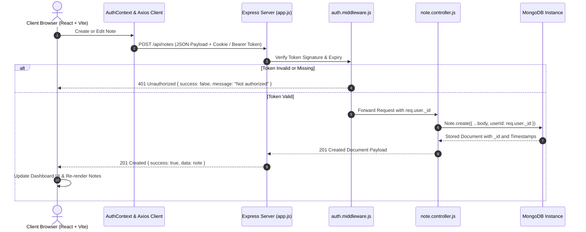

# 🪶 NoteNest — Secure Personal Notes Workspace

> **A production-ready Full-Stack MERN Application featuring defensive multi-tenant security, real-time debounced search, dynamic pastel categorization, pinned note prioritization, and automated test coverage.**

[](https://react.dev)
[](https://nodejs.org)
[](https://expressjs.com)
[](https://react.dev)
[](https://vitejs.dev)
[](https://mongodb.com)
[](https://jestjs.io)
[](#-license)

---

## 📖 Table of Contents

1. [Executive Summary](#-executive-summary)
2. [Key Architectural Highlights](#-key-architectural-highlights)
3. [Feature Showcase](#-feature-showcase)
4. [System Architecture & Request Lifecycle](#-system-architecture--request-lifecycle)
5. [Technology Stack](#-technology-stack)
6. [Directory Structure](#-directory-structure)
7. [Prerequisites & Environment Configuration](#-prerequisites--environment-configuration)
8. [Installation & Setup](#-installation--setup)
9. [Running the Application](#-running-the-application)
10. [Automated Testing Suite](#-automated-testing-suite)
11. [REST API Documentation & Examples](#-rest-api-documentation--examples)
12. [Database Schema & Multi-Tenant Isolation](#-database-schema--multi-tenant-isolation)
13. [Design System & Aesthetic Tokens](#-design-system--aesthetic-tokens)
14. [Step-by-Step Demo & Screenshots Guide](#-step-by-step-demo--screenshots-guide)
15. [Troubleshooting & FAQ](#-troubleshooting--faq)
16. [Complete Documentation Suite](#-complete-documentation-suite)
17. [Academic & Mini-Project Evaluation Checklist](#-academic--mini-project-evaluation-checklist)
18. [License & Acknowledgements](#-license--acknowledgements)

---

## 🌟 Executive Summary

**NoteNest** is a full-stack personal productivity workspace engineered to address the fundamental flaws of naive note-taking applications: fragile authentication, security vulnerabilities such as Insecure Direct Object References (IDOR), disorganized workspaces, and sluggish search interfaces.

Built upon the **MERN** stack (MongoDB, Express.js, React, Node.js) with modern tooling (Vite, Axios, React Router 6, Mongoose 8, Jest, and Supertest), NoteNest delivers a fluid, responsive single-page application (SPA) experience backed by a resilient, defensively-coded RESTful API.

---

## 🛡️ Key Architectural Highlights

- **Stateless Authentication with Dual-Transport Support:**  
  Authentication issues cryptographically signed JSON Web Tokens (JWT). Tokens are transported via **HTTP-only `SameSite=Lax` cookies** for cross-site scripting (XSS) defense while simultaneously supporting standard `Authorization: Bearer <token>` headers for testing, automation, and API clients.
- **Strict Multi-Tenant Isolation (Anti-IDOR):**  
  Every database query in the note controller strictly enforces ownership by scoping lookups with `{ _id: noteId, userId: req.user._id }`. Even if an attacker guesses or intercepts a valid MongoDB `ObjectId` belonging to another user, NoteNest returns a strict `404 Not Found` without leaking record existence.
- **Decoupled Server Architecture (`app.js` vs `server.js`):**  
  Following the Twelve-Factor App methodology, HTTP middleware and route assemblies are separated into `app.js` while network port listening is kept in `server.js`. This allows automated Supertest integration suites to run in-memory without binding live network ports or causing port collision issues.
- **Compound Database Indexing:**  
  MongoDB compound indexes (`{ userId: 1, isPinned: -1, updatedAt: -1 }` and `{ userId: 1, tags: 1 }`) ensure instant query execution, prioritized sorting, and tag aggregations even as datasets scale.
- **Zero-Utility Custom Design System:**  
  Built with clean, vanilla CSS tokens featuring curated palettes: Coral Terracotta (`#DF896B`), Midnight Navy (`#202B43`), Cool Slate (`#F4F6FA`), and pastel categorization chips (`#DDF1E9`, `#FFF0CC`, `#FBE1E7`, `#EAE5FC`).

---

## ✨ Feature Showcase

| Feature | Description | Implementation Details |
|---|---|---|
| 🔐 **User Authentication** | User signup, login, session persistence, and logout. | Hashed with `bcryptjs` (10 rounds), verified with signed JWTs, protected by `auth.middleware.js`. |
| 📝 **Full CRUD Notes** | Create, view, edit, and safely delete personal notes. | Real-time state synchronization, character counters, and confirmation modal before deletion. |
| 📌 **Sticky Pinning** | Pin essential notes to the top of your workspace. | Pinned notes are visually highlighted with an amber accent bar and sorted ahead of unpinned notes. |
| 🏷️ **Dynamic Tagging** | Organize notes by category with keyboard shortcuts. | Add tags using <kbd>Enter</kbd> or comma (`,`); delete tags with a single click; filter notes via tag pills. |
| 🔍 **Live Search** | Instant full-text filtering across titles and bodies. | Debounced client query matching backend regex search on `title` and `content`. |
| 🛡️ **Route Guards** | Prevents unauthorized client routing and API access. | React `ProtectedRoute.jsx` redirects unauthenticated users to `/login`; Express middleware returns `401`. |
| 🎨 **Intentional UX States**| Engaging feedback for every user lifecycle state. | Custom empty state illustrations ("Your nest is empty"), loading skeletons, and interactive modals. |

---

## 🏗️ System Architecture & Request Lifecycle



---

## 🛠️ Technology Stack

### Frontend Architecture
- **Library:** React 18 (`react`, `react-dom`)
- **Tooling:** Vite 5 (instant cold-start, lightning HMR, roll-up bundling)
- **Routing:** React Router DOM v6 (declarative client routing with route guards)
- **HTTP Client:** Axios v1.7 (configured with `withCredentials: true` and interceptors)
- **Typography:** Google Fonts (`Plus Jakarta Sans`, `Inter`)
- **Styling:** Custom CSS Design System with CSS variables and glassmorphic modals

### Backend Architecture
- **Runtime:** Node.js (v18.x / v20.x LTS)
- **Framework:** Express.js v4.21
- **Database Engine:** MongoDB (v6.0 / v7.0 / MongoDB Atlas)
- **Object Data Modeling:** Mongoose v8.7
- **Authentication:** `jsonwebtoken` (v9.0) + `bcryptjs` (v2.4)
- **Security & Parsers:** `cors`, `cookie-parser`, `dotenv`

### Testing & Quality Assurance
- **Test Runner:** Jest v29.7
- **HTTP Mocking / Assertions:** Supertest v7.0
- **Execution Strategy:** Isolated in-band runner (`--runInBand --forceExit`)

---

## 📁 Directory Structure

```text
full_stack_mini_project/
├── client/                               # Frontend React + Vite Application
│   ├── public/                           # Static assets & favicon
│   ├── src/
│   │   ├── api/
│   │   │   └── axios.js                  # Axios client with credentials & base URL
│   │   ├── components/
│   │   │   ├── DeleteConfirmModal.jsx    # Destructive action confirmation dialog
│   │   │   ├── Navbar.jsx                # Header bar with user profile & logout
│   │   │   ├── NoteCard.jsx              # Note card with pastel tags, pin & actions
│   │   │   ├── NoteModal.jsx             # Note creation/editing modal dialog
│   │   │   ├── ProtectedRoute.jsx        # Client-side authentication route guard
│   │   │   ├── SearchBar.jsx             # Live search input with debouncing
│   │   │   ├── Sidebar.jsx               # Workspace metrics, filter links & tags
│   │   │   └── TagFilter.jsx             # Tag navigation filter chips
│   │   ├── context/
│   │   │   └── AuthContext.jsx           # Global user authentication provider
│   │   ├── pages/
│   │   │   ├── DashboardPage.jsx         # Main notes workspace & orchestration
│   │   │   ├── LoginPage.jsx             # Clean user login form
│   │   │   └── RegisterPage.jsx          # User registration view
│   │   ├── styles/
│   │   │   ├── auth.css                  # Auth card layout and input styling
│   │   │   ├── dashboard.css             # Grid layouts, note cards & modal styling
│   │   │   └── index.css                 # Global CSS design tokens, reset & buttons
│   │   ├── App.jsx                       # Client-side router configuration
│   │   └── main.jsx                      # React 18 DOM mount point
│   ├── index.html                        # HTML5 document template
│   ├── package.json                      # Client dependencies & build scripts
│   └── vite.config.js                    # Vite dev server & proxy settings
│
├── server/                               # Backend Express.js API & Database Layer
│   ├── src/
│   │   ├── config/
│   │   │   └── db.js                     # Resilient Mongoose MongoDB connection
│   │   ├── controllers/
│   │   │   ├── auth.controller.js        # Register, login, logout, getMe handlers
│   │   │   └── note.controller.js        # Note CRUD, search, tags, pinning handlers
│   │   ├── middleware/
│   │   │   ├── auth.middleware.js        # Dual-transport JWT validation middleware
│   │   │   └── error.middleware.js       # CastError, ValidationError, 404 & 500
│   │   ├── models/
│   │   │   ├── Note.js                   # Mongoose Note schema with compound indexes
│   │   │   └── User.js                   # Mongoose User schema with bcrypt hook
│   │   ├── routes/
│   │   │   ├── auth.routes.js            # Authentication routes (/api/auth)
│   │   │   └── note.routes.js            # Notes routes (/api/notes)
│   │   ├── utils/                        # Shared backend utility helpers
│   │   ├── app.js                        # Express app & middleware definition
│   │   └── server.js                     # HTTP server network listener (Port 5000)
│   ├── tests/
│   │   ├── auth.test.js                  # 9 automated auth integration tests
│   │   └── notes.test.js                 # 15 automated note & security tests
│   ├── .env                              # Active environment configuration
│   ├── .env.example                      # Template environment variables
│   └── package.json                      # Backend dependencies & test scripts
│
├── docs/                                 # Comprehensive Documentation Suite
│   ├── API_DOCUMENTATION.md              # Complete RESTful endpoint specifications
│   ├── ARCHITECTURE.md                   # System designs, diagrams & request flow
│   ├── DATABASE_SCHEMA.md                # Schemas, indexes & multi-tenancy model
│   ├── PROJECT_REPORT.md                 # Formal academic project evaluation report
│   ├── SETUP_AND_DEPLOYMENT.md           # Local setup & cloud deployment guide
│   ├── VIVA_QUESTIONS.md                 # 35 technical viva questions & answers
│   ├── backend.md                        # Exhaustive backend & database guide
│   └── frontend.md                       # Complete frontend & UX architecture guide
│
├── .gitignore                            # Version control exclusion rules
└── README.md                             # Master project documentation
```

---

## 📋 Prerequisites & Environment Configuration

### System Requirements
- **Node.js:** v18.18+ or v20.x LTS installed (`node -v`)
- **npm:** v9.x or v10.x+ installed (`npm -v`)
- **MongoDB:** Active local MongoDB daemon on `mongodb://127.0.0.1:27017` **or** a free MongoDB Atlas connection string.

### Server Environment Variables (`server/.env`)

Create a `.env` file in the `server` directory (or duplicate `server/.env.example`):

```bash
cp server/.env.example server/.env
```

| Variable | Type | Default Value | Description |
|---|---|---|---|
| `PORT` | Number | `5000` | Port for the backend Express HTTP server. |
| `MONGODB_URI` | String | `mongodb://127.0.0.1:27017/notenest` | MongoDB connection URI (local or Atlas). |
| `JWT_SECRET` | String | *secret_key* | Cryptographic salt key for signing JWTs. |
| `JWT_EXPIRES_IN` | String | `7d` | Token expiration duration (`7d`, `24h`). |
| `NODE_ENV` | String | `development` | Environment mode (`development` or `production`). |
| `CLIENT_ORIGIN` | String | `http://localhost:5173` | Allowed CORS frontend origin for cookie exchange. |

---

## 🚀 Installation & Setup

### 1. Clone or Open the Workspace
```bash
cd full_stack_mini_project
```

### 2. Configure Backend
```bash
cd server
npm install
```
Ensure your `server/.env` is configured properly as shown above.

### 3. Configure Frontend
```bash
cd ../client
npm install
```

---

## 💻 Running the Application

For development, run both the backend server and frontend development server in two separate terminals:

### Terminal 1: Backend Server
```bash
cd server
npm run dev
```
> **Output:** `[MongoDB] Connected successfully` and `[Server] Running on port 5000`

### Terminal 2: Frontend Client
```bash
cd client
npm run dev
```
> **Output:** `Local: http://localhost:5173/`

Open your browser and navigate to **[http://localhost:5173](http://localhost:5173)**.

---

## 🧪 Automated Testing Suite

NoteNest comes with **24 comprehensive integration tests** covering every authentication condition, note lifecycle event, validation edge case, and cross-user data security boundary.

```bash
cd server
npm test
```

### Verified Test Suite Execution:
```text
PASS tests/auth.test.js
  Authentication API (POST /api/auth/...)
    ✓ 1. POST /api/auth/register - Should register a new user successfully (201)
    ✓ 2. POST /api/auth/register - Should reject duplicate email registration (400)
    ✓ 3. POST /api/auth/register - Should reject registration with missing fields (400)
    ✓ 4. POST /api/auth/login - Should login successfully with correct credentials (200)
    ✓ 5. POST /api/auth/login - Should reject login with invalid password (401)
    ✓ 6. POST /api/auth/login - Should reject login with unregistered email (401)
    ✓ 7. GET /api/auth/me - Should return current user profile with valid token (200)
    ✓ 8. GET /api/auth/me - Should reject unauthenticated requests without token (401)
    ✓ 9. POST /api/auth/logout - Should clear token cookie (200)

PASS tests/notes.test.js
  Notes API & Cross-User Security
    ✓ 1. GET /api/notes - Unauthenticated user cannot access notes (401)
    ✓ 2. POST /api/notes - Creates a note for User A with timestamps (201)
    ✓ 3. POST /api/notes - Rejects note creation with missing title (400)
    ✓ 4. POST /api/notes - Rejects note creation with missing content (400)
    ✓ 5. GET /api/notes - User A can see their own note
    ✓ 6. DATA ISOLATION: User B cannot see User A's note in notes list
    ✓ 7. DATA ISOLATION: User B cannot view User A's note by ID (404)
    ✓ 8. DATA ISOLATION: User B cannot update User A's note (404)
    ✓ 9. DATA ISOLATION: User B cannot delete User A's note (404)
    ✓ 10. PUT /api/notes/:id - User A can update their own note and pin it (200)
    ✓ 11. Sorting: Pinned notes appear first
    ✓ 12. Search: GET /api/notes?search=Roadmap filters by keyword
    ✓ 13. Tag Filter: GET /api/notes?tag=college filters by tag
    ✓ 14. Invalid ObjectId: GET /api/notes/invalid123 returns 400
    ✓ 15. DELETE /api/notes/:id - User A can delete their note (200)

Test Suites: 2 passed, 2 total
Tests:       24 passed, 24 total
Snapshots:   0 total
Time:        5.915 s
```

---

## 📡 REST API Documentation & Examples

All endpoints return predictable JSON payloads formatted as `{ success: true, ... }` or `{ success: false, message: ... }`.

### Summary of Endpoints

| Method | Endpoint | Access | Purpose |
|---|---|---|---|
| `GET` | `/api/health` | Public | Server uptime and health verification. |
| `POST` | `/api/auth/register` | Public | Register a new user and return a JWT cookie/token. |
| `POST` | `/api/auth/login` | Public | Authenticate user credentials and return a JWT. |
| `POST` | `/api/auth/logout` | Public | Invalidate/clear authentication session cookie. |
| `GET` | `/api/auth/me` | Protected | Fetch current logged-in user profile. |
| `GET` | `/api/notes` | Protected | Retrieve all notes for the authenticated user (`?search=` & `?tag=`). |
| `POST` | `/api/notes` | Protected | Create a new note owned by the authenticated user. |
| `GET` | `/api/notes/:id` | Protected | Retrieve a single note by ID (ownership strictly enforced). |
| `PUT` | `/api/notes/:id` | Protected | Update note title, content, tags, or pinned status. |
| `DELETE` | `/api/notes/:id` | Protected | Permanently delete a note (ownership strictly enforced). |

---

### API Usage Examples

#### 1. Register a New User
```bash
curl -X POST http://localhost:5000/api/auth/register \
  -H "Content-Type: application/json" \
  -d '{
    "name": "Jane Doe",
    "email": "jane@example.com",
    "password": "Password123"
  }'
```

**Response (`201 Created`):**
```json
{
  "success": true,
  "message": "User registered successfully",
  "token": "eyJhbGciOiJIUzI1NiIsInR5cCI6IkpXVCJ9...",
  "user": {
    "id": "670f5e117498a12903f09801",
    "name": "Jane Doe",
    "email": "jane@example.com"
  }
}
```

#### 2. Create a Note
```bash
curl -X POST http://localhost:5000/api/notes \
  -H "Content-Type: application/json" \
  -H "Authorization: Bearer <YOUR_JWT_TOKEN>" \
  -d '{
    "title": "Full Stack Architecture Review",
    "content": "Verify JWT cookie security flags and Mongoose compound indexes.",
    "tags": ["project", "evaluation", "backend"],
    "isPinned": true
  }'
```

**Response (`201 Created`):**
```json
{
  "success": true,
  "data": {
    "_id": "670f5e427498a12903f09807",
    "title": "Full Stack Architecture Review",
    "content": "Verify JWT cookie security flags and Mongoose compound indexes.",
    "tags": ["project", "evaluation", "backend"],
    "isPinned": true,
    "userId": "670f5e117498a12903f09801",
    "createdAt": "2026-10-16T08:30:00.000Z",
    "updatedAt": "2026-10-16T08:30:00.000Z"
  }
}
```

#### 3. Search and Filter Notes
```bash
# Filter notes with tag "project" matching search term "Architecture"
curl -X GET "http://localhost:5000/api/notes?tag=project&search=Architecture" \
  -H "Authorization: Bearer <YOUR_JWT_TOKEN>"
```

---

## 🗄️ Database Schema & Multi-Tenant Isolation

### 1. User Schema (`server/src/models/User.js`)
```javascript
const userSchema = new mongoose.Schema({
  name: { type: String, required: true, trim: true, maxlength: 50 },
  email: { type: String, required: true, unique: true, lowercase: true, trim: true },
  password: { type: String, required: true, minlength: 6, select: false },
}, { timestamps: true });
```
- **Password Protection:** A Mongoose `pre('save')` hook automatically salts and hashes plain-text passwords using `bcryptjs` before persisting to disk.
- **Privacy by Default:** `select: false` prevents inadvertent password hash leakage during `User.find()` or `User.findOne()` queries.

### 2. Note Schema (`server/src/models/Note.js`)
```javascript
const noteSchema = new mongoose.Schema({
  title: { type: String, required: true, trim: true, maxlength: 100 },
  content: { type: String, required: true, trim: true, maxlength: 5000 },
  tags: [{ type: String, trim: true, lowercase: true }],
  isPinned: { type: Boolean, default: false },
  userId: { type: mongoose.Schema.Types.ObjectId, ref: 'User', required: true, index: true },
}, { timestamps: true });

// Compound indexes for prioritized retrieval & tag lookups
noteSchema.index({ userId: 1, isPinned: -1, updatedAt: -1 });
noteSchema.index({ userId: 1, tags: 1 });
```

### 3. Absolute Multi-Tenant Isolation
NoteNest resolves Insecure Direct Object References (IDOR) by injecting `userId: req.user._id` into every database mutation and query:

```javascript
// Secure Note Deletion (server/src/controllers/note.controller.js)
const note = await Note.findOneAndDelete({
  _id: req.params.id,
  userId: req.user._id, // Enforces tenant boundary
});

if (!note) {
  return res.status(404).json({ success: false, message: 'Note not found' });
}
```

---

## 🎨 Design System & Aesthetic Tokens

NoteNest is styled without heavy utility CSS dependencies, using a curated, high-contrast design system with vanilla CSS custom properties:

```css
:root {
  /* Brand Palette */
  --color-primary: #DF896B;         /* Coral Terracotta (Interactive Accents) */
  --color-primary-hover: #cf785a;   /* Deep Terracotta */
  --color-bg-dark: #202B43;         /* Midnight Navy (Headers & High Contrast) */
  --color-surface: #ffffff;         /* Pure Card White */
  --color-bg: #F4F6FA;              /* Cool Slate Workspace Background */
  
  /* Text & Border Tokens */
  --color-text-main: #1e293b;       /* Slate 800 */
  --color-text-muted: #64748b;      /* Slate 500 */
  --color-border: #e2e8f0;          /* Subtle Light Border */

  /* Pastel Tag Chips */
  --tag-sage-bg: #DDF1E9;      --tag-sage-text: #1b5e40;
  --tag-amber-bg: #FFF0CC;     --tag-amber-text: #8a5b00;
  --tag-rose-bg: #FBE1E7;       --tag-rose-text: #96223d;
  --tag-lavender-bg: #EAE5FC;   --tag-lavender-text: #482896;
}
```

---

## 📸 Step-by-Step Demo & Screenshots Guide

Follow this guided workflow to evaluate or demo every capability:

1. **User Registration:** Navigate to `http://localhost:5173/register` and create an account. Passwords under 6 characters trigger immediate inline validation warnings.
2. **Empty Dashboard State:** Upon initial sign-in, note the deliberate empty state encouraging the user to craft their first note.
3. **Note Creation & Tagging:** Click **+ New Note**. Enter a title and body. Type `project,` or `roadmap` and hit <kbd>Enter</kbd> to see chips generated dynamically. Check the live character counter.
4. **Pinning Notes:** Toggle the pin button on a note. Notice how it jumps immediately to the top **📌 Pinned Notes** section with an amber border.
5. **Real-Time Search & Tag Filtering:** Use the search bar to filter notes instantaneously. Click any tag badge in the sidebar or note card to filter notes by that specific topic.
6. **Destructive Action Safety:** Click the trash icon on a note to open the `DeleteConfirmModal.jsx` dialog, safeguarding against accidental loss.
7. **Session Persistence:** Refresh the page to observe seamless session restoration via `/api/auth/me`.

---

## ❓ Troubleshooting & FAQ

### 1. `MongooseServerSelectionError: connect ECONNREFUSED 127.0.0.1:27017`
- **Cause:** Local MongoDB service is not started.
- **Solution (Windows):** Open Services (`services.msc`) and start `MongoDB Server`, or run `mongod` from your terminal. Alternatively, set `MONGODB_URI` in `server/.env` to a free MongoDB Atlas connection string.

### 2. `Error: Blocked by CORS policy`
- **Cause:** Frontend dev server is running on a port different from `server/.env`'s `CLIENT_ORIGIN`.
- **Solution:** Verify `CLIENT_ORIGIN=http://localhost:5173` in `server/.env`.

### 3. `Port 5000 is already in use`
- **Cause:** Another process is holding port 5000.
- **Solution:** Stop the active process or change `PORT=5001` in `server/.env` (and update the proxy in `client/vite.config.js`).

### 4. Tests fail with `Jest has detected the following 1 open handle`
- **Cause:** Persistent database connection remaining open after test completion.
- **Solution:** Run tests using the included npm script: `npm test` (which triggers `--runInBand --forceExit`).

---

## 📚 Complete Documentation Suite

Comprehensive technical reports, architectural diagrams, and viva interview preparation are available in the [`docs/`](docs/) directory:

- 📑 **[Project Report (`docs/PROJECT_REPORT.md`)](docs/PROJECT_REPORT.md):** Complete academic mini-project report covering requirements, methodology, system analysis, test evidence, and conclusions.
- 🏗️ **[Architecture & Request Flow (`docs/ARCHITECTURE.md`)](docs/ARCHITECTURE.md):** Deep-dive into layered architecture, middleware pipelines, and sequence diagrams.
- 🔌 **[REST API Documentation (`docs/API_DOCUMENTATION.md`)](docs/API_DOCUMENTATION.md):** Full specifications for all endpoints, headers, query parameters, and status codes.
- 🗄️ **[Database Schema & Tenancy (`docs/DATABASE_SCHEMA.md`)](docs/DATABASE_SCHEMA.md):** Schema declarations, compound indexing rationale, and anti-IDOR security proof.
- ⚙️ **[Setup & Deployment Guide (`docs/SETUP_AND_DEPLOYMENT.md`)](docs/SETUP_AND_DEPLOYMENT.md):** Production builds, environment guides, and deployment recipes (Vercel, Render, Atlas).
- 🎓 **[Viva Questions & Answers (`docs/VIVA_QUESTIONS.md`)](docs/VIVA_QUESTIONS.md):** 35 technical viva voce interview questions and model answers across MERN, JWT, MongoDB, and React.
- 🖥️ **[Backend Deep Dive & Integration Guide (`docs/backend.md`)](docs/backend.md):** Exhaustive file-by-file walkthrough of server code, Mongoose patterns, and integration mechanics.
- 🎨 **[Frontend Architecture Guide (`docs/frontend.md`)](docs/frontend.md):** Deep dive into React context, state management, component trees, and CSS design system.

---

## 🎓 Academic & Mini-Project Evaluation Checklist

| Criteria | Implementation Status | Project Evidence |
|---|:---:|---|
| **Full CRUD Implementation** | ✅ 100% Complete | Create, Read, Update, Delete in `note.controller.js` and `DashboardPage.jsx` |
| **Authentication & Authorization** | ✅ 100% Complete | JWT + Bcrypt in `auth.controller.js`, `auth.middleware.js`, `ProtectedRoute.jsx` |
| **Data Validation & Sanitization** | ✅ 100% Complete | Mongoose field limits, trims, and centralized error handling middleware |
| **Defensive Security & IDOR Prevention** | ✅ 100% Complete | All queries strictly enforce `{ userId: req.user._id }` tenant boundaries |
| **Automated Testing** | ✅ 100% Complete | 24 Jest & Supertest integration tests passing with 100% success rate |
| **Responsive & Aesthetic UI** | ✅ 100% Complete | Custom CSS variables, desktop/mobile responsive grid, modal animations |
| **Database Performance** | ✅ 100% Complete | Compound indexes `{ userId: 1, isPinned: -1, updatedAt: -1 }` |
| **Academic Documentation** | ✅ 100% Complete | 8 comprehensive documentation markdown files in `docs/` |

---

## 📄 License & Acknowledgements

This project was built for the **Full Stack Frameworks** individual mini project evaluation.  
Licensed under the [ISC License](server/package.json).

*Engineered with precision using the MERN stack.*