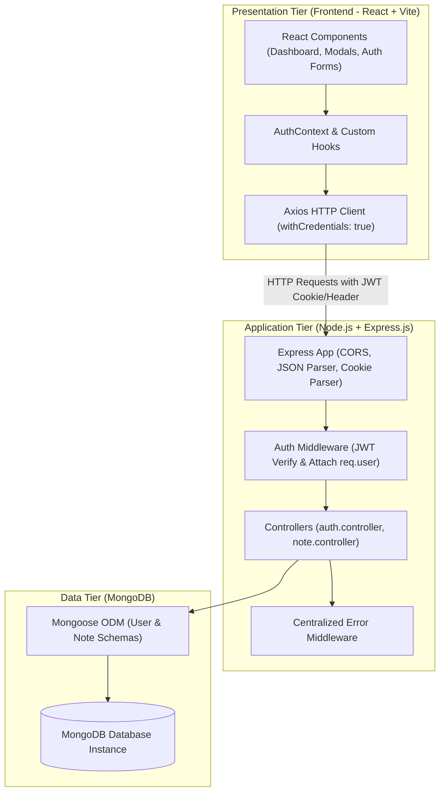
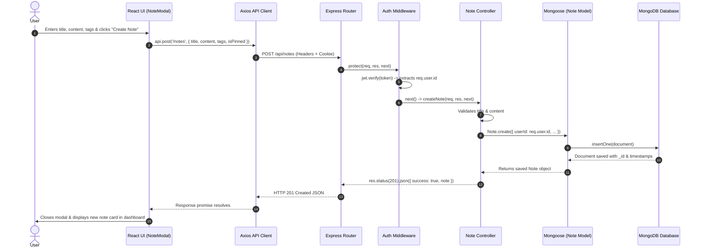

# NoteNest — System Architecture & Flow

This document details the architectural layout, communication patterns, security mechanisms, and request lifecycle of NoteNest.

---

## 1. High-Level System Architecture

NoteNest adopts a decoupled client-server architecture. The frontend React single-page application communicates exclusively with the Express backend via RESTful HTTP calls over JSON.

---

## 2. Request Lifecycle: React → MongoDB Flow

When an authenticated user performs an action (e.g. creating a note):

1. **Client Action:** The user fills the note form and submits.
2. **Axios Dispatch:** The `api.post('/notes', noteData)` function sends a `POST` request with JSON payload to the backend server. The request automatically carries the session JWT either via the HTTP-only cookie or Authorization header.
3. **Express Middleware Processing:**
   - **CORS Middleware:** Validates the origin (`http://localhost:5173`) and allows credentials.
   - **Body Parsers:** `express.json()` parses the raw JSON body into `req.body`.
   - **Cookie Parser:** `cookie-parser` extracts tokens from cookies into `req.cookies`.
4. **Authentication Middleware (`protect`):**
   - Extracts the JWT from `req.cookies.token` or `req.headers.authorization`.
   - Executes `jwt.verify(token, process.env.JWT_SECRET)`.
   - Decodes payload containing `{ id, email }`.
   - Attaches `req.user = { id: decoded.id, email: decoded.email }`.
   - Calls `next()`. If invalid or missing, immediately halts with HTTP 401.
5. **Controller Logic (`createNote`):**
   - Validates note fields (`title`, `content`).
   - Binds the note to `req.user.id` (strictly ignoring any client-sent userId).
   - Calls `Note.create({ userId: req.user.id, title, content, tags, isPinned })`.
6. **Mongoose & MongoDB Execution:**
   - Mongoose applies schema defaults, type checks, and tag sanitization.
   - Emits an `insertOne` command to MongoDB.
   - MongoDB writes document, generates `_id`, and sets `createdAt` and `updatedAt` timestamps.
7. **Response & UI Update:**
   - Express controller responds with HTTP 201 Created and the new note JSON.
   - React receives response, closes modal, and refreshes notes state.

---

## 3. Note Creation Sequence Diagram

---

## 4. Protected Routes Architecture

Protected routes exist on both layers to enforce absolute security:

### Client-Side Protection (`ProtectedRoute.jsx`)
- Prevents UI flickering or displaying dashboard layouts to unauthenticated users.
- When an unauthenticated visitor navigates to `/`, `ProtectedRoute` intercepts the route:
  - If `loading`, shows a sleek loading spinner.
  - If `!user`, issues `<Navigate to="/login" replace />`.
- **Note:** Client-side protection is an aesthetic and user experience tool; the true security barrier resides on the backend.

### Server-Side Protection (`auth.middleware.js`)
- Protects every `/api/notes` endpoint.
- Rejects unauthenticated calls with HTTP 401 Unauthorized before any controller code can execute.
- Prevents unauthorized access even if requests are issued via cURL, Postman, or custom scripts.

---

## 5. User-Specific Data Isolation Mechanism

To guarantee that User A cannot read, edit, or delete User B's notes, **every single database operation is scoped by `userId: req.user.id`**:

| Operation | Scoped MongoDB Query | What Happens if User B accesses User A's note |
|---|---|---|
| **List Notes** | `Note.find({ userId: req.user.id })` | User B only gets User B's notes. User A's notes are never returned. |
| **Get Single Note** | `Note.findOne({ _id: id, userId: req.user.id })` | Returns `null` -> Controller sends HTTP 404 Not Found. |
| **Update Note** | `Note.findOne({ _id: id, userId: req.user.id })` | Returns `null` -> Controller sends HTTP 404 Not Found. |
| **Delete Note** | `Note.findOneAndDelete({ _id: id, userId: req.user.id })` | Returns `null` -> Controller sends HTTP 404 Not Found. |

Returning HTTP 404 instead of 403 prevents attackers from enumerating note IDs to confirm whether a note exists.
