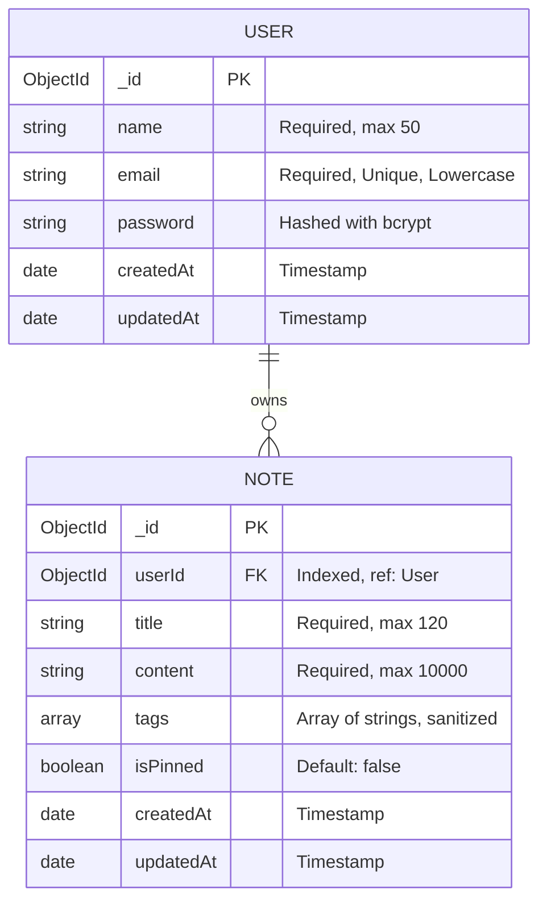

# NoteNest — Database Schema Documentation

This document describes the MongoDB collections, Mongoose schemas, data types, constraints, relationships, indexes, and tenancy design of NoteNest.

---

## 1. Entity-Relationship Model (One-to-Many)

NoteNest implements a classic **1:N (One-to-Many)** relationship between Users and Notes. One User can own many Notes, while every Note belongs to exactly one User.



---

## 2. User Schema (`server/src/models/User.js`)

### Schema Definition
```javascript
{
  name: {
    type: String,
    required: [true, 'Please provide your full name'],
    trim: true,
    minlength: 2,
    maxlength: 50
  },
  email: {
    type: String,
    required: [true, 'Please provide an email address'],
    unique: true,
    lowercase: true,
    trim: true,
    match: [/^[^\s@]+@[^\s@]+\.[^\s@]+$/, 'Please provide a valid email address']
  },
  password: {
    type: String,
    required: [true, 'Please provide a password'],
    minlength: 6
  }
}
```

### Options & Hooks:
- `timestamps: true`: Mongoose automatically adds and manages `createdAt` and `updatedAt` ISO date fields.
- `pre('save')`: Hashes password using `bcryptjs.hash(password, salt)` if the password field was modified.
- `methods.comparePassword(candidate)`: Compares plaintext input with hashed password via `bcrypt.compare`.
- `methods.toJSON()`: Excludes `password` whenever the document is serialized to JSON.

### Example User Document in MongoDB:
```json
{
  "_id": { "$oid": "670ba5e80123456789abcdef" },
  "name": "Aarav Sharma",
  "email": "aarav@example.com",
  "password": "$2a$10$e8V91Fk9z8n.m3J98x1G8.bF2f8w1Jk0...",
  "createdAt": { "$date": "2026-10-13T09:23:13.088Z" },
  "updatedAt": { "$date": "2026-10-13T09:23:13.088Z" },
  "__v": 0
}
```

---

## 3. Note Schema (`server/src/models/Note.js`)

### Schema Definition
```javascript
{
  userId: {
    type: mongoose.Schema.Types.ObjectId,
    ref: 'User',
    required: [true, 'Note must belong to a user'],
    index: true
  },
  title: {
    type: String,
    required: [true, 'Note title is required'],
    trim: true,
    maxlength: [120, 'Title cannot exceed 120 characters']
  },
  content: {
    type: String,
    required: [true, 'Note content is required'],
    trim: true,
    maxlength: [10000, 'Content cannot exceed 10000 characters']
  },
  tags: {
    type: [String],
    default: [],
    set: (tags) => Array.from(new Set(tags.map(t => t.trim().toLowerCase()).filter(t => t.length > 0)))
  },
  isPinned: {
    type: Boolean,
    default: false
  }
}
```

### Compound Indexes:
1. `{ userId: 1, isPinned: -1, updatedAt: -1 }`:
   - **Why this index exists:** The primary dashboard query fetches a user's notes sorted with pinned notes first and newest updates next. This compound index satisfies the query and sort simultaneously without requiring an in-memory sort operation.
2. `{ userId: 1, tags: 1 }`:
   - **Why this index exists:** Speeds up user-specific tag queries (e.g. `GET /api/notes?tag=college`).

### Example Note Document in MongoDB:
```json
{
  "_id": { "$oid": "6acdf8819953627df9fc9140" },
  "userId": { "$oid": "670ba5e80123456789abcdef" },
  "title": "Full Stack Frameworks Exam",
  "content": "Evaluation on 16 October 2026. Review React state, Express middleware, and MongoDB schemas.",
  "tags": ["college", "exam", "mern"],
  "isPinned": true,
  "createdAt": { "$date": "2026-10-13T09:23:13.088Z" },
  "updatedAt": { "$date": "2026-10-13T09:25:40.112Z" },
  "__v": 0
}
```

---

## 4. How User-Specific Isolation Works

1. **Foreign Key Enactment:** Every Note stores `userId`.
2. **Server-Side Enforcement:** The controller derives `req.user.id` from the verified JWT.
3. **Double-Key Querying:** When querying or modifying a note by ID, the query is always `{ _id: noteId, userId: req.user.id }`.
   - If User A attempts to request User B's Note ID (`6acdf8819953627df9fc9140`), MongoDB returns `null` because the `userId` does not match User A.
   - The controller returns `404 Not Found`.
   - Result: Absolute multi-tenant data isolation.
