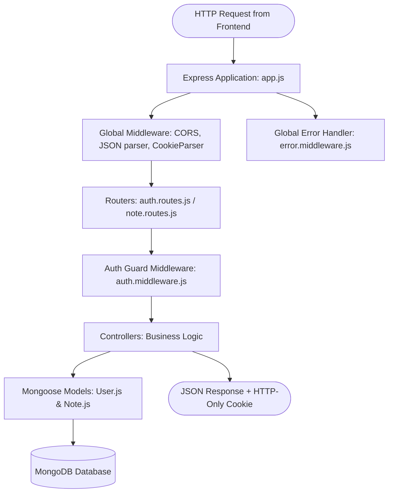
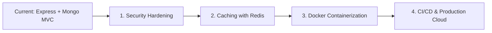

# NoteNest Backend Architecture, Database & Full-Stack Integration Guide

> **Document Location:** `docs/backend.md`  
> **Application:** NoteNest Personal Notes Workspace (Server & Database)  
> **Tech Stack:** Node.js, Express.js, MongoDB, Mongoose ODM, JWT, Bcrypt.js, Supertest & Jest  

---

## Table of Contents
1. [Backend Overview & Architecture](#1-backend-overview--architecture)
2. [Directory Tree & File Map](#2-directory-tree--file-map)
3. [Configuration & Startup Layer](#3-configuration--startup-layer)
   - [package.json](#packagejson)
   - [.env & .env.example](#env--envexample)
   - [src/server.js](#srcserverjs)
   - [src/app.js](#srcappjs)
   - [src/config/db.js](#srcconfigdbjs)
4. [Data Models & Schema Design (Mongoose)](#4-data-models--schema-design-mongoose)
   - [src/models/User.js](#srcmodelsuserjs)
   - [src/models/Note.js](#srcmodelsnotejs)
5. [Controllers Layer (Business Logic)](#5-controllers-layer-business-logic)
   - [src/controllers/auth.controller.js](#srccontrollersauthcontrollerjs)
   - [src/controllers/note.controller.js](#srccontrollersnotecontrollerjs)
6. [Routes Layer (API Endpoints)](#6-routes-layer-api-endpoints)
   - [src/routes/auth.routes.js](#srcroutesauthroutesjs)
   - [src/routes/note.routes.js](#srcroutesnoteroutesjs)
7. [Middleware Layer (Security & Error Handling)](#7-middleware-layer-security--error-handling)
   - [src/middleware/auth.middleware.js](#srcmiddlewareauthmiddlewarejs)
   - [src/middleware/error.middleware.js](#srcmiddlewareerrormiddlewarejs)
8. [Automated Test Suite](#8-automated-test-suite)
   - [tests/auth.test.js & tests/notes.test.js](#testsauthtestjs--testsnotestestjs)
9. [Deep Dive: Database Concepts & MongoDB ("Database Things")](#9-deep-dive-database-concepts--mongodb-database-things)
   - [Why MongoDB & NoSQL?](#why-mongodb--nosql)
   - [Mongoose as an ODM](#mongoose-as-an-odm)
   - [Relational Modeling via Document References](#relational-modeling-via-document-references)
   - [Indexing Strategy & Performance](#indexing-strategy--performance)
   - [Multi-Tenant Data Isolation](#multi-tenant-data-isolation)
10. [Full-Stack Integration: Connecting Frontend & Backend](#10-full-stack-integration-connecting-frontend--backend)
   - [The Complete Request-Response Lifecycle](#the-complete-request-response-lifecycle)
   - [Bridging Network Requests: Proxy vs CORS](#bridging-network-requests-proxy-vs-cors)
   - [Authentication Bridge (Cookies vs Headers)](#authentication-bridge-cookies-vs-headers)
   - [Step-by-Step: Running the Entire Full-Stack App](#step-by-step-running-the-entire-full-stack-app)
   - [Common Full-Stack Gotchas & Troubleshooting](#common-full-stack-gotchas--troubleshooting)
11. [Next Steps for Backend Mastery](#11-next-steps-for-backend-mastery)

---

## 1. Backend Overview & Architecture

The NoteNest backend is a **RESTful Web API** built with **Node.js** and **Express.js**, using **MongoDB** as its persistent document database and **Mongoose** as the Object Data Modeling (ODM) library.

The backend adopts a **layered architectural pattern (Separation of Concerns)**:



### Architectural Principles Applied:
- **Separation of App and Server (`app.js` vs `server.js`):** `app.js` builds and configures Express routes without binding to a network port. This allows the Jest/Supertest test suite to import `app` directly for fast in-memory testing without port collisions. `server.js` handles startup, connects to MongoDB, and calls `app.listen()`.
- **Stateless RESTful Design:** All requests carry their own authentication credential (JWT in an HTTP-only cookie or Authorization header). The server stores no in-memory session tables, enabling effortless horizontal scaling.
- **Fail-Safe Multi-Tenancy:** Controllers enforce `{ userId: req.user.id }` in every MongoDB query, preventing users from viewing or altering each other's data.

---

## 2. Directory Tree & File Map

Here is the complete file organization of the `server/` project:

```
server/
├── package.json                 # Backend scripts, production & dev dependencies
├── package-lock.json            # Lockfile ensuring deterministic module versions
├── .env                         # Local environment variables (PORT, MONGO_URI, JWT_SECRET)
├── .env.example                 # Example environment template for new developers
├── src/
│   ├── server.js                # Server entry point; connects to DB and listens on port
│   ├── app.js                   # Express app setup, CORS, middleware, routes mount
│   ├── config/
│   │   └── db.js                # Mongoose database connection setup and error logging
│   ├── models/
│   │   ├── User.js              # User schema, password hashing hook, bcrypt verification
│   │   └── Note.js              # Note schema, validation, tags sanitization, indexes
│   ├── controllers/
│   │   ├── auth.controller.js   # User registration, login, logout, profile checks
│   │   └── note.controller.js   # Note CRUD, search, tag filtering, pin toggling
│   ├── routes/
│   │   ├── auth.routes.js       # Endpoints for /api/auth/*
│   │   └── note.routes.js       # Endpoints for /api/notes/*
│   ├── middleware/
│   │   ├── auth.middleware.js   # JWT token verification and user extraction guard
│   │   └── error.middleware.js  # 404 handler and centralized JSON error formatter
│   └── utils/                   # Shared utility helpers (reserved for extensibility)
└── tests/
    ├── auth.test.js             # Automated integration tests for authentication endpoints
    └── notes.test.js            # Automated integration tests for note CRUD endpoints
```

---

## 3. Configuration & Startup Layer

### `package.json`
* **File Location:** [`server/package.json`](file:///c:/Users/LENOVO/Desktop/fullstack-prac/full_stack_mini_project/server/package.json)
* **Why it is used:** Manages project configuration and libraries:
  - `express` (v4.21.1): Web framework for handling HTTP routing and middleware.
  - `mongoose` (v8.7.1): ODM for MongoDB schemas and queries.
  - `bcryptjs` (v2.4.3): Pure JS implementation for hashing passwords using salt rounds.
  - `jsonwebtoken` (v9.0.2): Standard implementation for signing and verifying JWTs.
  - `cookie-parser` (v1.4.6): Parses `Cookie` headers and populates `req.cookies`.
  - `cors` (v2.8.5): Enables Cross-Origin Resource Sharing.
  - `dotenv` (v16.4.5): Loads environment variables from `.env` into `process.env`.
  - `nodemon` (v3.1.7): Watches for file changes during development and automatically restarts the server.
  - `jest` & `supertest`: Automated integration testing suite.

---

### `.env` & `.env.example`
* **File Location:** [`server/.env.example`](file:///c:/Users/LENOVO/Desktop/fullstack-prac/full_stack_mini_project/server/.env.example)
* **Why it is used:** Keeps sensitive configurations and secrets out of source code:
  - `PORT=5000`: Port on which Express listens.
  - `MONGODB_URI=mongodb://127.0.0.1:27017/notenest`: MongoDB connection string.
  - `JWT_SECRET`: Cryptographic secret key used by HMAC SHA-256 to sign tokens.
  - `JWT_EXPIRES_IN=7d`: Token validity duration.
  - `CLIENT_ORIGIN=http://localhost:5173`: Allowed frontend URL for CORS.
  - `NODE_ENV=development`: Sets application environment.

---

### `src/server.js`
* **File Location:** [`server/src/server.js`](file:///c:/Users/LENOVO/Desktop/fullstack-prac/full_stack_mini_project/server/src/server.js)
* **Why it is used:** The startup script executed when running `npm start` or `npm run dev`. It connects to MongoDB first, then starts listening on the designated TCP port. It also handles unhandled promise rejections gracefully to prevent zombie processes.

#### Core Code:
```javascript
const app = require('./app');
const connectDB = require('./config/db');

const PORT = process.env.PORT || 5000;

const startServer = async () => {
  try {
    await connectDB();
    const server = app.listen(PORT, () => {
      console.log(`🚀 NoteNest Server running on http://localhost:${PORT}`);
    });

    process.on('unhandledRejection', (err) => {
      console.error(`Unhandled Rejection Error: ${err.message}`);
      server.close(() => process.exit(1));
    });
  } catch (error) {
    console.error(`Failed to start server: ${error.message}`);
    process.exit(1);
  }
};

startServer();
```

---

### `src/app.js`
* **File Location:** [`server/src/app.js`](file:///c:/Users/LENOVO/Desktop/fullstack-prac/full_stack_mini_project/server/src/app.js)
* **Why it is used:** Central configuration hub for Express. Assembles middleware in the exact required order:
  1. **CORS:** Configures origin filtering and enables `credentials: true` so browsers can exchange cookies.
  2. **Body Parsers:** `express.json({ limit: '1mb' })` parses JSON payloads; `express.urlencoded` parses HTML form data.
  3. **Cookie Parser:** `cookieParser()` reads HTTP-only cookies from incoming requests.
  4. **Health Check:** `GET /api/health` returns status `200 OK` for monitoring and smoke tests.
  5. **Routers:** Mounts `/api/auth` and `/api/notes`.
  6. **Catch-All 404:** Passes unmatched routes to `notFound`.
  7. **Global Error Handler:** Catches errors and formats them into clean JSON responses.

#### Core Code:
```javascript
const express = require('express');
const cors = require('cors');
const cookieParser = require('cookie-parser');
const dotenv = require('dotenv');

dotenv.config();

const authRoutes = require('./routes/auth.routes');
const noteRoutes = require('./routes/note.routes');
const { notFound, errorHandler } = require('./middleware/error.middleware');

const app = express();

const allowedOrigins = [
  process.env.CLIENT_ORIGIN || 'http://localhost:5173',
  'http://127.0.0.1:5173',
];

app.use(cors({
  origin: function (origin, callback) {
    if (!origin || allowedOrigins.indexOf(origin) !== -1) {
      callback(null, true);
    } else {
      callback(new Error('Blocked by CORS policy'));
    }
  },
  credentials: true,
  methods: ['GET', 'POST', 'PUT', 'DELETE', 'OPTIONS'],
  allowedHeaders: ['Content-Type', 'Authorization'],
}));

app.use(express.json({ limit: '1mb' }));
app.use(express.urlencoded({ extended: true }));
app.use(cookieParser());

// Health Check
app.get('/api/health', (req, res) => {
  res.status(200).json({ status: 'ok', service: 'NoteNest API', timestamp: new Date().toISOString() });
});

app.use('/api/auth', authRoutes);
app.use('/api/notes', noteRoutes);

app.use(notFound);
app.use(errorHandler);

module.exports = app;
```

---

### `src/config/db.js`
* **File Location:** [`server/src/config/db.js`](file:///c:/Users/LENOVO/Desktop/fullstack-prac/full_stack_mini_project/server/src/config/db.js)
* **Why it is used:** Encapsulates Mongoose database connection logic. Isolating this into a standalone function allows tests to connect to a dedicated test database (`notenest_test_auth`) and disconnect cleanly when tests complete.

#### Core Code:
```javascript
const mongoose = require('mongoose');

const connectDB = async () => {
  try {
    const conn = await mongoose.connect(process.env.MONGODB_URI || 'mongodb://127.0.0.1:27017/notenest');
    console.log(`[MongoDB] Connected successfully: ${conn.connection.host}/${conn.connection.name}`);
    return conn;
  } catch (error) {
    console.error(`[MongoDB] Connection error: ${error.message}`);
    if (process.env.NODE_ENV !== 'test') {
      process.exit(1);
    }
    throw error;
  }
};

module.exports = connectDB;
```

---

## 4. Data Models & Schema Design (Mongoose)

### `src/models/User.js`
* **File Location:** [`server/src/models/User.js`](file:///c:/Users/LENOVO/Desktop/fullstack-prac/full_stack_mini_project/server/src/models/User.js)
* **Why it is used:** Defines the User entity, validates emails using regular expressions, automatically salts and hashes passwords before writing to disk, and protects sensitive fields from serialization.

#### Detailed Code Breakdown:
```javascript
const mongoose = require('mongoose');
const bcrypt = require('bcryptjs');

const userSchema = new mongoose.Schema(
  {
    name: {
      type: String,
      required: [true, 'Please provide your full name'],
      trim: true,
      minlength: [2, 'Name must be at least 2 characters long'],
      maxlength: [50, 'Name cannot exceed 50 characters'],
    },
    email: {
      type: String,
      required: [true, 'Please provide an email address'],
      unique: true,      // Creates a unique index in MongoDB to block duplicates
      lowercase: true,   // Normalizes 'User@Example.com' to 'user@example.com'
      trim: true,
      match: [/^[^\s@]+@[^\s@]+\.[^\s@]+$/, 'Please provide a valid email address'],
    },
    password: {
      type: String,
      required: [true, 'Please provide a password'],
      minlength: [6, 'Password must be at least 6 characters long'],
    },
  },
  { timestamps: true } // Auto-manages createdAt and updatedAt
);

// Pre-save hook: Hash password with salt rounds before storing
userSchema.pre('save', async function (next) {
  if (!this.isModified('password')) return next();
  try {
    const salt = await bcrypt.genSalt(10);
    this.password = await bcrypt.hash(this.password, salt);
    next();
  } catch (err) {
    next(err);
  }
});

// Instance method: Safely verify candidate password against bcrypt hash
userSchema.methods.comparePassword = async function (candidatePassword) {
  return bcrypt.compare(candidatePassword, this.password);
};

// Strips password when converting document to JSON
userSchema.methods.toJSON = function () {
  const userObject = this.toObject();
  delete userObject.password;
  return userObject;
};

const User = mongoose.model('User', userSchema);
module.exports = User;
```

---

### `src/models/Note.js`
* **File Location:** [`server/src/models/Note.js`](file:///c:/Users/LENOVO/Desktop/fullstack-prac/full_stack_mini_project/server/src/models/Note.js)
* **Why it is used:** Defines the Note entity, enforces ownership via `userId`, sanitizes tags, and defines compound database indexes for sub-millisecond querying.

#### Detailed Code Breakdown:
```javascript
const mongoose = require('mongoose');

const noteSchema = new mongoose.Schema(
  {
    userId: {
      type: mongoose.Schema.Types.ObjectId,
      ref: 'User',       // Foreign key reference to User model
      required: [true, 'Note must belong to a user'],
      index: true,       // Indexed for fast lookup
    },
    title: {
      type: String,
      required: [true, 'Note title is required'],
      trim: true,
      maxlength: [120, 'Title cannot exceed 120 characters'],
    },
    content: {
      type: String,
      required: [true, 'Note content is required'],
      trim: true,
      maxlength: [10000, 'Content cannot exceed 10000 characters'],
    },
    tags: {
      type: [String],
      default: [],
      // Custom setter: sanitizes, trims, lowercases, and deduplicates tags
      set: (tags) => {
        if (!Array.isArray(tags)) return [];
        return Array.from(
          new Set(
            tags
              .map((t) => (typeof t === 'string' ? t.trim().toLowerCase() : ''))
              .filter((t) => t.length > 0 && t.length <= 30)
          )
        );
      },
    },
    isPinned: {
      type: Boolean,
      default: false,
    },
  },
  { timestamps: true }
);

// Compound Indexes for high performance
noteSchema.index({ userId: 1, isPinned: -1, updatedAt: -1 });
noteSchema.index({ userId: 1, tags: 1 });

const Note = mongoose.model('Note', noteSchema);
module.exports = Note;
```

---

## 5. Controllers Layer (Business Logic)

Controllers house all domain logic, validate request parameters, interact with Mongoose models, and return structured JSON responses.

### `src/controllers/auth.controller.js`
* **File Location:** [`server/src/controllers/auth.controller.js`](file:///c:/Users/LENOVO/Desktop/fullstack-prac/full_stack_mini_project/server/src/controllers/auth.controller.js)
* **Core Functions:**
  1. `generateToken(user)`: Signs a JWT payload containing `{ id: user._id, email: user.email }` with a 7-day expiration.
  2. `getCookieOptions()`: Returns security options (`httpOnly: true`, `sameSite: 'lax'`, `secure: production`).
  3. `register`: Checks for email duplication, calls `User.create()`, signs token, sets cookie, returns `201 Created`.
  4. `login`: Finds user by email, verifies password via `user.comparePassword()`, sets cookie, returns `200 OK`.
  5. `logout`: Calls `res.clearCookie('token')`, clearing the browser's credential.
  6. `getMe`: Uses `req.user.id` from `protect` middleware to return current user profile.

---

### `src/controllers/note.controller.js`
* **File Location:** [`server/src/controllers/note.controller.js`](file:///c:/Users/LENOVO/Desktop/fullstack-prac/full_stack_mini_project/server/src/controllers/note.controller.js)
* **Core Functions:**
  1. `getNotes`:
     - Reads `search` and `tag` query parameters.
     - Builds MongoDB query object: `{ userId: req.user.id }`.
     - Adds regex search for title and content: `$or: [{ title: { $regex, $options: 'i' } }, { content: { $regex, $options: 'i' } }]`.
     - Sorts pinned notes first (`isPinned: -1`), then newest (`updatedAt: -1`).
  2. `getNoteById`:
     - Validates ObjectId format with `mongoose.Types.ObjectId.isValid(id)`.
     - Finds note strictly requiring `{ _id: id, userId: req.user.id }`.
  3. `createNote`:
     - Validates `title` and `content`.
     - Explicitly injects `userId: req.user.id`. **Never trusts a user ID from the request body.**
  4. `updateNote`:
     - Validates ownership before modifying fields. Calls `note.save()` to run validations and refresh `updatedAt`.
  5. `deleteNote`:
     - Atomically finds and deletes via `Note.findOneAndDelete({ _id: id, userId: req.user.id })`.

---

## 6. Routes Layer (API Endpoints)

### `src/routes/auth.routes.js`
* **File Location:** [`server/src/routes/auth.routes.js`](file:///c:/Users/LENOVO/Desktop/fullstack-prac/full_stack_mini_project/server/src/routes/auth.routes.js)

```javascript
const express = require('express');
const router = express.Router();
const { register, login, logout, getMe } = require('../controllers/auth.controller');
const { protect } = require('../middleware/auth.middleware');

router.post('/register', register);
router.post('/login', login);
router.post('/logout', logout);
router.get('/me', protect, getMe);

module.exports = router;
```

---

### `src/routes/note.routes.js`
* **File Location:** [`server/src/routes/note.routes.js`](file:///c:/Users/LENOVO/Desktop/fullstack-prac/full_stack_mini_project/server/src/routes/note.routes.js)

```javascript
const express = require('express');
const router = express.Router();
const { getNotes, getNoteById, createNote, updateNote, deleteNote } = require('../controllers/note.controller');
const { protect } = require('../middleware/auth.middleware');

// Protect ALL note routes with JWT verification
router.use(protect);

router.route('/')
  .get(getNotes)
  .post(createNote);

router.route('/:id')
  .get(getNoteById)
  .put(updateNote)
  .delete(deleteNote);

module.exports = router;
```

---

## 7. Middleware Layer (Security & Error Handling)

### `src/middleware/auth.middleware.js`
* **File Location:** [`server/src/middleware/auth.middleware.js`](file:///c:/Users/LENOVO/Desktop/fullstack-prac/full_stack_mini_project/server/src/middleware/auth.middleware.js)
* **Why it is used:** Guarantees that only authenticated requests reach private endpoints.
* **Dual-Extraction Flow:**
  1. Inspects `req.cookies.token` (sent automatically by web browsers).
  2. If missing, checks `req.headers.authorization` for `Bearer <token>` (used by mobile apps, Postman, and automated tests).
  3. Verifies token signature using `jwt.verify(token, JWT_SECRET)`.
  4. Attaches `{ id, email }` to `req.user` and calls `next()`.
  5. Returns `401 Unauthorized` if token is missing, forged, or expired.

#### Core Code:
```javascript
const jwt = require('jsonwebtoken');

const protect = (req, res, next) => {
  let token = null;

  if (req.cookies && req.cookies.token) {
    token = req.cookies.token;
  } else if (req.headers.authorization && req.headers.authorization.startsWith('Bearer ')) {
    token = req.headers.authorization.split(' ')[1];
  }

  if (!token) {
    return res.status(401).json({ success: false, message: 'Access denied. No token provided.' });
  }

  try {
    const decoded = jwt.verify(token, process.env.JWT_SECRET || 'fallback_secret');
    req.user = { id: decoded.id, email: decoded.email };
    next();
  } catch (error) {
    if (error.name === 'TokenExpiredError') {
      return res.status(401).json({ success: false, message: 'Session expired. Please log in again.' });
    }
    return res.status(401).json({ success: false, message: 'Invalid authentication token.' });
  }
};

module.exports = { protect };
```

---

### `src/middleware/error.middleware.js`
* **File Location:** [`server/src/middleware/error.middleware.js`](file:///c:/Users/LENOVO/Desktop/fullstack-prac/full_stack_mini_project/server/src/middleware/error.middleware.js)
* **Why it is used:** Unifies error handling across the entire backend, catching database exceptions and formatting them into clean JSON without crashing the server.
* **Special Cases Handled:**
  - `CastError`: When an invalid MongoDB ObjectId string is supplied (e.g. `/api/notes/invalid123`), returns `400 Bad Request`.
  - `ValidationError`: Mongoose schema validation failures (e.g. title missing), returns `400 Bad Request` with combined messages.
  - `code 11000`: MongoDB duplicate key error (e.g. duplicate email registration), returns friendly message instead of a raw MongoDB driver crash.

---

## 8. Automated Test Suite

NoteNest comes equipped with automated integration tests in `server/tests/`:

* [`tests/auth.test.js`](file:///c:/Users/LENOVO/Desktop/fullstack-prac/full_stack_mini_project/server/tests/auth.test.js):
  - Validates user registration (`201 Created`), email uniqueness (`400`), missing fields (`400`).
  - Verifies login with correct password (`200 OK`) and incorrect password (`401 Unauthorized`).
  - Checks HTTP-only cookie emission (`Set-Cookie: token=...`).
  - Verifies `/api/auth/me` session authentication.
* [`tests/notes.test.js`](file:///c:/Users/LENOVO/Desktop/fullstack-prac/full_stack_mini_project/server/tests/notes.test.js):
  - Validates note creation, reading, updating, and deletion.
  - **Data Isolation Test:** Creates Note A for User 1, logs in as User 2, and confirms that User 2 gets `404 Not Found` when trying to view or delete Note A.

You can run the tests anytime with:
```bash
npm test
```

---

## 9. Deep Dive: Database Concepts & MongoDB ("Database Things")

### Why MongoDB & NoSQL?
MongoDB is a **document-oriented NoSQL database**. Unlike relational databases (MySQL, PostgreSQL) which store data in rigid rows and columns with fixed tables, MongoDB stores data in flexible **BSON** (Binary JSON) documents.

| Concept | Relational (SQL) | MongoDB (NoSQL) | NoteNest Implementation |
| :--- | :--- | :--- | :--- |
| Data Store | Database | Database | `notenest` database |
| Grouping | Table | Collection | `users` and `notes` collections |
| Record | Row | Document | BSON document `{ _id, title, ... }` |
| Primary Key | `id INT AUTO_INCREMENT` | `_id ObjectId` | 12-byte unique BSON identifier |
| Dynamic Attributes| Requires `ALTER TABLE` | Native to document | Tags array `['college', 'react']` |

### Mongoose as an ODM
Directly writing raw MongoDB driver queries (`db.collection('notes').insertOne(...)`) lacks structure. **Mongoose** provides:
1. **Schema Definition:** Declares expected fields, default values, and data types (`String`, `Boolean`, `ObjectId`).
2. **Built-in Validation:** Enforces constraints before anything touches the database (e.g., `minlength: 6`, regex checks).
3. **Middleware Hooks:** Runs pre/post operations like hashing passwords before saving (`pre('save')`).
4. **Custom Methods:** Attaches helper functions directly to documents (`user.comparePassword(candidate)`).

### Relational Modeling via Document References
NoteNest uses a **One-to-Many normalized reference model**:
- One User owns Many Notes.
- Each note contains a field `userId: mongoose.Schema.Types.ObjectId` referencing the `User` document.

> **Why NOT embed notes inside the User document?**  
> While MongoDB allows embedding arrays of subdocuments inside a parent document, embedding thousands of notes inside a single user document would eventually hit MongoDB's **16MB document size limit**. Referencing allows unbounded scalability, simple note pagination, and isolated updates.

### Indexing Strategy & Performance
When querying a collection without indexes, MongoDB must perform a **Collection Scan (`COLLSCAN`)**, reading every document from disk. NoteNest builds compound indexes to achieve index scans (`IXSCAN`):

```javascript
// Compound Index 1: Optimizes the primary dashboard query
noteSchema.index({ userId: 1, isPinned: -1, updatedAt: -1 });

// Compound Index 2: Optimizes tag filtering for a user
noteSchema.index({ userId: 1, tags: 1 });
```

* **Why Order Matters (Equality, Sort, Range - ESR Rule):**
  1. `userId: 1`: Filters notes down to only the requesting user (Equality).
  2. `isPinned: -1`: Groups pinned notes (`true`) ahead of unpinned notes (`false`) (Sort).
  3. `updatedAt: -1`: Sorts matching notes by most recently modified first (Sort).

### Multi-Tenant Data Isolation
Multi-tenancy means multiple users share the same database instance. The greatest security risk is **Insecure Direct Object Reference (IDOR)**: an attacker passes someone else's note `_id` into `PUT /api/notes/:id` to overwrite their data.

NoteNest completely prevents this by enforcing user ownership in the query predicate:

```javascript
// SECURE: Finds the note ONLY IF both the _id AND the owner userId match
const note = await Note.findOne({ _id: id, userId: req.user.id });
if (!note) {
  return res.status(404).json({ message: 'Note not found or unauthorized.' });
}
```
Even if an attacker guesses a valid Note ID, MongoDB returns `null`, and the server sends a `404 Not Found`.

---

## 10. Full-Stack Integration: Connecting Frontend & Backend

### The Complete Request-Response Lifecycle

Here is what happens when a user creates a note in NoteNest:

```mermaid
sequenceDiagram
    autonumber
    actor User as User Browser
    participant Modal as React NoteModal
    participant Axios as axios.js Instance
    participant Vite as Vite Dev Proxy (:5173)
    participant Express as Express Server (:5000)
    participant AuthMW as protect Middleware
    participant Controller as note.controller.js
    participant MongoDB as MongoDB Database

    User->>Modal: Types title, content & clicks "Save Note"
    Modal->>Axios: api.post('/notes', { title, content, tags })
    Axios->>Vite: POST http://localhost:5173/api/notes (Cookie attached)
    Vite->>Express: Forwards to http://localhost:5000/api/notes
    Express->>AuthMW: protect middleware runs
    AuthMW->>AuthMW: Decodes JWT from cookie; attaches req.user = { id: '...' }
    AuthMW->>Controller: Calls createNote(req, res)
    Controller->>MongoDB: Note.create({ userId: req.user.id, title, ... })
    MongoDB-->>Controller: Returns saved Note BSON document
    Controller-->>Express: res.status(201).json({ success: true, note })
    Express-->>Vite: HTTP 201 Response
    Vite-->>Axios: Delivers JSON payload
    Axios-->>Modal: Promise resolves with response data
    Modal->>User: Closes modal & updates Dashboard state with new note card!
```

---

### Bridging Network Requests: Proxy vs CORS

When running full-stack applications locally, the frontend runs on port `5173` (Vite) and the backend runs on port `5000` (Express). Because the ports differ, browsers enforce **Same-Origin Policy**.

NoteNest solves this with a **two-layer bridge**:
1. **Local Development (Vite Proxy):**  
   `client/vite.config.js` sets up a proxy mapping `/api` to `http://localhost:5000`. The browser believes it is talking to port `5173`, completely bypassing CORS checks in development.
2. **Production Cross-Origin (Express CORS):**  
   `server/src/app.js` configures the `cors` middleware with `credentials: true` and validates against `CLIENT_ORIGIN`, allowing safe production deployment across separate domains (e.g., frontend on Vercel, backend on Render).

---

### Authentication Bridge (Cookies vs Headers)

NoteNest implements a **dual-mode authentication bridge**:

```
[Server Login/Register]
       │
       ├── 1. res.cookie('token', token, { httpOnly: true })  ──► Stored securely in browser cookie jar (Immune to XSS)
       │
       └── 2. res.json({ token, user })                       ──► Saved in localStorage for API client compatibility
```

* **On Every Request:** `axios.js` sets `withCredentials: true`, prompting the browser to automatically include the `token` cookie. In addition, an Axios interceptor attaches `Authorization: Bearer <token>` from `localStorage` as a fallback.
* **On Server Verification:** `auth.middleware.js` checks the cookie first; if empty, it inspects the Authorization header.

---

### Step-by-Step: Running the Entire Full-Stack App

#### 1. Prerequisites
- **Node.js** installed (v18.x or v20.x recommended): `node -v`
- **MongoDB** running locally or a MongoDB Atlas connection string.

#### 2. Start MongoDB
* **Windows Service:** Ensure MongoDB service is running via Windows Services or run:
  ```powershell
  net start MongoDB
  ```
  *(Or start mongod manually: `mongod --dbpath="C:\data\db"`)*

#### 3. Start Backend Server
Open a terminal in `server/`:
```bash
cd server
npm install
npm run dev
```
You should see:
```
🚀 NoteNest Server running in development mode
🌐 Listening on http://localhost:5000
📡 Health Check: http://localhost:5000/api/health
[MongoDB] Connected successfully: 127.0.0.1:27017/notenest
```

#### 4. Start Frontend Client
Open a second terminal in `client/`:
```bash
cd client
npm install
npm run dev
```
You should see:
```
  VITE v5.4.10  ready in 240 ms

  ➜  Local:   http://localhost:5173/
```

#### 5. Verify the Connection
Open your browser to `http://localhost:5173`. You can register a new account, create notes with tags, toggle pins, search notes, and verify that data persists directly into MongoDB.

---

### Common Full-Stack Gotchas & Troubleshooting

| Issue / Symptom | Root Cause | Solution |
| :--- | :--- | :--- |
| `ERR_CONNECTION_REFUSED 127.0.0.1:27017` | MongoDB daemon is not running. | Start MongoDB service (`net start MongoDB`) or verify your `MONGODB_URI` in `.env`. |
| `Blocked by CORS policy` in browser console | The client origin is not in Express `allowedOrigins` list. | Check `CLIENT_ORIGIN` in `server/.env`. Ensure it matches `http://localhost:5173`. |
| Login works, but reload redirects back to `/login` | Cookie is rejected or not sent due to cross-site restrictions. | Ensure `withCredentials: true` is set in `axios.js` and `credentials: true` is enabled in Express `cors()`. |
| `Port 5000 is already in use (EADDRINUSE)` | A previous Node process is still running in the background. | Kill the process using port 5000: `npx kill-port 5000` or change `PORT=5001` in `.env` and `vite.config.js`. |
| Search returns empty results unexpectedly | Regex search didn't escape special characters or case mismatch. | In `note.controller.js`, regex search uses `$options: 'i'` for case-insensitivity. |

---

## 11. Next Steps for Backend Mastery

To level up your backend engineering skills beyond this project, explore these professional practices:



1. **Security Hardening:**
   - **`helmet`:** Express middleware that sets secure HTTP response headers (Content-Security-Policy, X-Frame-Options).
   - **`express-rate-limit`:** Defends against brute-force password guessing by capping requests per IP (e.g., max 10 login attempts per 15 minutes).
2. **Performance Caching with Redis:**
   - Cache frequent query results (e.g., `GET /api/notes`) in Redis memory. Invalidate the cache when a note is created, updated, or deleted.
3. **Dockerization:**
   - Write a `Dockerfile` for client and server, and a `docker-compose.yml` that boots Express, Vite, and MongoDB with a single command (`docker-compose up`).
4. **Refresh Token Rotation:**
   - Upgrade authentication to use short-lived Access Tokens (15 minutes) and rotating Refresh Tokens stored securely in the database to mitigate stolen token risks.
