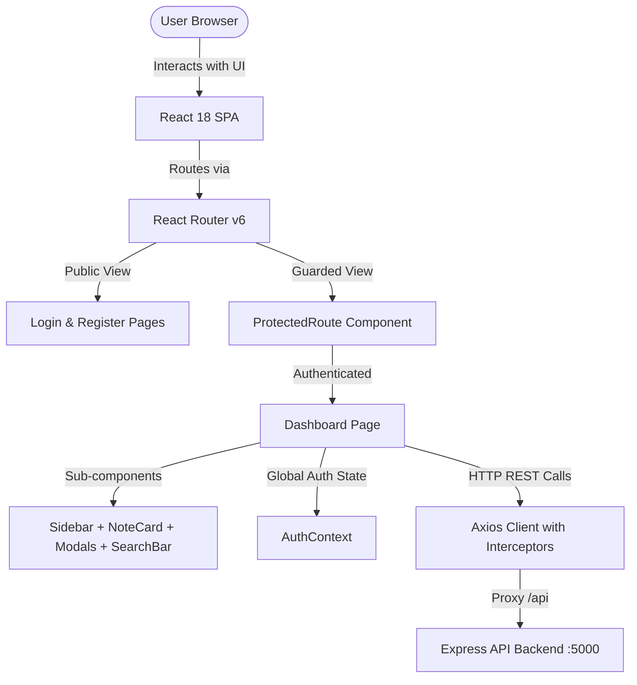
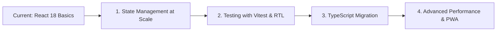

# NoteNest Frontend Architecture & Code Guide

> **Document Location:** `docs/frontend.md`  
> **Application:** NoteNest Personal Notes Workspace (Client)  
> **Tech Stack:** React 18, Vite 5, React Router v6, Axios, Vanilla CSS Variables Design System  

---

## Table of Contents
1. [Overview & Frontend Architecture](#1-overview--frontend-architecture)
2. [Directory Tree & File Map](#2-directory-tree--file-map)
3. [Configuration & Root Files](#3-configuration--root-files)
   - [index.html](#indexhtml)
   - [vite.config.js](#viteconfigjs)
   - [package.json](#packagejson)
   - [src/main.jsx](#srcmainjsx)
   - [src/App.jsx](#srcappjsx)
4. [API & State Layer](#4-api--state-layer)
   - [src/api/axios.js](#srcapiaxiosjs)
   - [src/context/AuthContext.jsx](#srccontextauthcontextjsx)
5. [Components Layer](#5-components-layer)
   - [src/components/ProtectedRoute.jsx](#srccomponentsprotectedroutejsx)
   - [src/components/Navbar.jsx](#srccomponentsnavbarjsx)
   - [src/components/Sidebar.jsx](#srccomponentssidebarjsx)
   - [src/components/NoteCard.jsx](#srccomponentsnotecardjsx)
   - [src/components/NoteModal.jsx](#srccomponentsnotemodaljsx)
   - [src/components/SearchBar.jsx](#srccomponentssearchbarjsx)
   - [src/components/TagFilter.jsx](#srccomponentstagfilterjsx)
   - [src/components/DeleteConfirmModal.jsx](#srccomponentsdeleteconfirmmodaljsx)
6. [Pages Layer (Views)](#6-pages-layer-views)
   - [src/pages/LoginPage.jsx](#srcpagesloginpagejsx)
   - [src/pages/RegisterPage.jsx](#srcpagesregisterpagejsx)
   - [src/pages/DashboardPage.jsx](#srcpagesdashboardpagejsx)
7. [Styles & Design System](#7-styles--design-system)
   - [src/styles/index.css](#srcstylesindexcss)
   - [src/styles/auth.css](#srcstylesauthcss)
   - [src/styles/dashboard.css](#srcstylesdashboardcss)
8. [Core React Concepts in Action](#8-core-react-concepts-in-action)
9. [What You Need to Understand Next (Learning Roadmap)](#9-what-you-need-to-understand-next-learning-roadmap)

---

## 1. Overview & Frontend Architecture

The frontend of **NoteNest** is designed as a **Single Page Application (SPA)** built with React 18 and Vite. Unlike traditional multi-page websites where every click requests a fresh HTML page from a remote server, NoteNest loads a single HTML file (`index.html`) once. Subsequent page changes, modal transitions, and note updates happen instantly in the browser through client-side routing and asynchronous REST API calls.



### Key Architectural Strengths:
- **Component-Driven Development:** Every UI element (cards, modals, badges, search bar) is isolated into a reusable React component with its own responsibilities.
- **Single Source of Truth for Auth:** User session state is managed centrally via the React Context API (`AuthContext`), preventing messy prop-drilling.
- **Defensive Routing:** Unauthenticated users are intercepted by `ProtectedRoute` and redirected to `/login` with their intended target preserved.
- **Optimized Network Interception:** `axios.js` automatically attaches JWT Bearer headers and sends HTTP-only session cookies with all outgoing requests.

---

## 2. Directory Tree & File Map

Here is the complete file organization of the `client/` project:

```
client/
├── index.html                   # HTML template and root DOM mounting container
├── package.json                 # Project dependencies, scripts, and build metadata
├── package-lock.json            # Exact dependency resolution lockfile
├── vite.config.js               # Vite build tool and development server proxy config
└── src/
    ├── main.jsx                 # Application entry point; attaches React to DOM
    ├── App.jsx                  # Main routing definition and AuthProvider wrapper
    ├── api/
    │   └── axios.js             # Centralized Axios instance with interceptors
    ├── context/
    │   └── AuthContext.jsx       # Global authentication state, login, register, logout
    ├── components/
    │   ├── ProtectedRoute.jsx   # Route guard shielding private routes
    │   ├── Navbar.jsx           # Top header with user profile badge and logout
    │   ├── Sidebar.jsx          # Left navigation, tabs, dynamic tag counts
    │   ├── NoteCard.jsx         # Card component displaying individual note items
    │   ├── NoteModal.jsx        # Dual-mode modal for creating and updating notes
    │   ├── SearchBar.jsx        # Live note search input with clear trigger
    │   ├── TagFilter.jsx        # Clickable tag pill bar for categorization
    │   └── DeleteConfirmModal.jsx # Defensive modal preventing accidental deletion
    ├── pages/
    │   ├── LoginPage.jsx        # User login form with client validation
    │   ├── RegisterPage.jsx     # User signup form with password confirmation
    │   └── DashboardPage.jsx    # Primary notes workspace and state manager
    └── styles/
        ├── index.css            # Global CSS variables, reset, buttons, forms, alert styles
        ├── auth.css             # Authentication view layout, cards, and animations
        └── dashboard.css        # Workspace grid layout, sidebar, note cards, tags
```

---

## 3. Configuration & Root Files

### `index.html`
* **File Location:** [`client/index.html`](file:///c:/Users/LENOVO/Desktop/fullstack-prac/full_stack_mini_project/client/index.html)
* **Why it is used:** Every SPA needs a root HTML shell. The browser loads this file first. It contains the `<div id="root"></div>` where React renders the entire user interface, loads Google Fonts (Inter font family), and links the Vite module script (`/src/main.jsx`).

#### Core Code:
```html
<!DOCTYPE html>
<html lang="en">
  <head>
    <meta charset="UTF-8" />
    <link rel="icon" type="image/svg+xml" href="/vite.svg" />
    <meta name="viewport" content="width=device-width, initial-scale=1.0" />
    <title>NoteNest - Secure Personal Notes</title>
    <!-- Google Fonts: Inter -->
    <link rel="preconnect" href="https://fonts.googleapis.com" />
    <link rel="preconnect" href="https://fonts.gstatic.com" crossorigin />
    <link href="https://fonts.googleapis.com/css2?family=Inter:wght@300;400;500;600;700;800&display=swap" rel="stylesheet" />
  </head>
  <body>
    <div id="root"></div>
    <script type="module" src="/src/main.jsx"></script>
  </body>
</html>
```

---

### `vite.config.js`
* **File Location:** [`client/vite.config.js`](file:///c:/Users/LENOVO/Desktop/fullstack-prac/full_stack_mini_project/client/vite.config.js)
* **Why it is used:** Configures the **Vite** bundler and development server. Crucially, it sets up a **development reverse proxy**. When the client code requests `/api/notes`, Vite intercepts the request on port `5173` and silently forwards it to `http://localhost:5000/api/notes`. This avoids Cross-Origin Resource Sharing (CORS) headaches during local development.

#### Core Code:
```javascript
import { defineConfig } from 'vite';
import react from '@vitejs/plugin-react';

export default defineConfig({
  plugins: [react()],
  server: {
    port: 5173,
    proxy: {
      '/api': {
        target: 'http://localhost:5000',
        changeOrigin: true,
        secure: false,
      },
    },
  },
});
```

---

### `package.json`
* **File Location:** [`client/package.json`](file:///c:/Users/LENOVO/Desktop/fullstack-prac/full_stack_mini_project/client/package.json)
* **Why it is used:** Defines frontend metadata, npm scripts (`dev`, `build`, `preview`), and dependencies:
  - `react` & `react-dom` (v18.3.1): Core UI library.
  - `react-router-dom` (v6.27.0): Client-side URL routing.
  - `axios` (v1.7.7): Promise-based HTTP client.
  - `vite` & `@vitejs/plugin-react`: Ultra-fast build engine with Hot Module Replacement (HMR).

---

### `src/main.jsx`
* **File Location:** [`client/src/main.jsx`](file:///c:/Users/LENOVO/Desktop/fullstack-prac/full_stack_mini_project/client/src/main.jsx)
* **Why it is used:** The JavaScript entry point. It imports the global CSS design tokens (`./styles/index.css`), finds `<div id="root"></div>` in the DOM using `document.getElementById('root')`, and creates the React root via `ReactDOM.createRoot()`.

#### Core Code:
```jsx
import React from 'react';
import ReactDOM from 'react-dom/client';
import App from './App.jsx';
import './styles/index.css';

ReactDOM.createRoot(document.getElementById('root')).render(
  <React.StrictMode>
    <App />
  </React.StrictMode>
);
```

---

### `src/App.jsx`
* **File Location:** [`client/src/App.jsx`](file:///c:/Users/LENOVO/Desktop/fullstack-prac/full_stack_mini_project/client/src/App.jsx)
* **Why it is used:** Sets up client-side page routing using React Router v6. It declares which page component should be rendered for each URL path, wraps the application inside the `AuthProvider`, and establishes the boundary between public routes and authenticated protected routes.

#### Core Code Breakdown:
```jsx
import React from 'react';
import { BrowserRouter as Router, Routes, Route, Navigate } from 'react-router-dom';
import { AuthProvider } from './context/AuthContext';
import ProtectedRoute from './components/ProtectedRoute';
import LoginPage from './pages/LoginPage';
import RegisterPage from './pages/RegisterPage';
import DashboardPage from './pages/DashboardPage';

const App = () => {
  return (
    <Router>
      <AuthProvider>
        <Routes>
          {/* Public Routes: Anyone can access */}
          <Route path="/login" element={<LoginPage />} />
          <Route path="/register" element={<RegisterPage />} />

          {/* Protected Route: Accessible only when authenticated */}
          <Route
            path="/"
            element={
              <ProtectedRoute>
                <DashboardPage />
              </ProtectedRoute>
            }
          />

          {/* Fallback Catch-All: Redirects undefined URLs to / */}
          <Route path="*" element={<Navigate to="/" replace />} />
        </Routes>
      </AuthProvider>
    </Router>
  );
};

export default App;
```

---

## 4. API & State Layer

### `src/api/axios.js`
* **File Location:** [`client/src/api/axios.js`](file:///c:/Users/LENOVO/Desktop/fullstack-prac/full_stack_mini_project/client/src/api/axios.js)
* **Why it is used:** Rather than writing `fetch('http://localhost:5000/api/notes', ...)` in every component, NoteNest creates a single pre-configured Axios instance.
* **Key Features:**
  - `baseURL: '/api'`: Points directly to the Vite proxy route.
  - `withCredentials: true`: Instructs the browser to send HTTP-only cookies (the `token` cookie) across requests.
  - **Request Interceptor:** Checks `localStorage` for `notenest_token`. If present, automatically injects `Authorization: Bearer <token>` into the HTTP headers as a dual-mode fallback.
  - **Response Interceptor:** Intercepts `401 Unauthorized` responses globally. If the user's session expires, it clears local credentials so the app cleanly drops back to the login screen.

#### Core Code:
```javascript
import axios from 'axios';

const api = axios.create({
  baseURL: '/api',
  withCredentials: true,
  headers: {
    'Content-Type': 'application/json',
  },
});

// Request Interceptor: Attach JWT Bearer token if present
api.interceptors.request.use(
  (config) => {
    const token = localStorage.getItem('notenest_token');
    if (token) {
      config.headers.Authorization = `Bearer ${token}`;
    }
    return config;
  },
  (error) => Promise.reject(error)
);

// Response Interceptor: Purge credentials on 401 Unauthorized
api.interceptors.response.use(
  (response) => response,
  (error) => {
    if (error.response && error.response.status === 401) {
      localStorage.removeItem('notenest_token');
      localStorage.removeItem('notenest_user');
    }
    return Promise.reject(error);
  }
);

export default api;
```

---

### `src/context/AuthContext.jsx`
* **File Location:** [`client/src/context/AuthContext.jsx`](file:///c:/Users/LENOVO/Desktop/fullstack-prac/full_stack_mini_project/client/src/context/AuthContext.jsx)
* **Why it is used:** Implements React Context to eliminate **prop drilling**. Any component in the app can instantly check `user`, `loading`, or call `login()`, `register()`, and `logout()` using the custom hook `useAuth()`.
* **Session Restoration on Mount:** When the browser refreshes, `useEffect` executes an asynchronous call to `/api/auth/me`. If the cookie/token is valid, the user state is restored without forcing the user to log in again.

#### Core Code Breakdown:
```jsx
import React, { createContext, useContext, useState, useEffect } from 'react';
import api from '../api/axios';

const AuthContext = createContext(null);

export const AuthProvider = ({ children }) => {
  const [user, setUser] = useState(() => {
    const saved = localStorage.getItem('notenest_user');
    return saved ? JSON.parse(saved) : null;
  });
  const [loading, setLoading] = useState(true);

  // Check auth status on initial application load
  useEffect(() => {
    const checkAuthStatus = async () => {
      try {
        const res = await api.get('/auth/me');
        if (res.data.success && res.data.user) {
          setUser(res.data.user);
          localStorage.setItem('notenest_user', JSON.stringify(res.data.user));
        }
      } catch (err) {
        setUser(null);
        localStorage.removeItem('notenest_user');
        localStorage.removeItem('notenest_token');
      } finally {
        setLoading(false);
      }
    };
    checkAuthStatus();
  }, []);

  const login = async (email, password) => {
    const res = await api.post('/auth/login', { email, password });
    if (res.data.success) {
      setUser(res.data.user);
      localStorage.setItem('notenest_user', JSON.stringify(res.data.user));
      if (res.data.token) localStorage.setItem('notenest_token', res.data.token);
      return res.data.user;
    }
  };

  const register = async (name, email, password) => {
    const res = await api.post('/auth/register', { name, email, password });
    if (res.data.success) {
      setUser(res.data.user);
      localStorage.setItem('notenest_user', JSON.stringify(res.data.user));
      if (res.data.token) localStorage.setItem('notenest_token', res.data.token);
      return res.data.user;
    }
  };

  const logout = async () => {
    try {
      await api.post('/auth/logout');
    } finally {
      setUser(null);
      localStorage.removeItem('notenest_user');
      localStorage.removeItem('notenest_token');
    }
  };

  return (
    <AuthContext.Provider value={{ user, loading, login, register, logout }}>
      {children}
    </AuthContext.Provider>
  );
};

export const useAuth = () => {
  const context = useContext(AuthContext);
  if (!context) throw new Error('useAuth must be used within an AuthProvider');
  return context;
};
```

---

## 5. Components Layer

### `src/components/ProtectedRoute.jsx`
* **File Location:** [`client/src/components/ProtectedRoute.jsx`](file:///c:/Users/LENOVO/Desktop/fullstack-prac/full_stack_mini_project/client/src/components/ProtectedRoute.jsx)
* **Why it is used:** Serves as a frontend security guard. If a user is not authenticated (`user === null`), it halts rendering and performs a redirect to `/login`, preserving `state={{ from: location }}` so the user returns to their requested page after logging in.

#### Key Code:
```jsx
const ProtectedRoute = ({ children }) => {
  const { user, loading } = useAuth();
  const location = useLocation();

  if (loading) {
    return <div className="spinner">Authenticating session...</div>;
  }

  if (!user) {
    return <Navigate to="/login" state={{ from: location }} replace />;
  }

  return children;
};
```

---

### `src/components/Navbar.jsx`
* **File Location:** [`client/src/components/Navbar.jsx`](file:///c:/Users/LENOVO/Desktop/fullstack-prac/full_stack_mini_project/client/src/components/Navbar.jsx)
* **Why it is used:** Displays the top application branding header, the active user's avatar initial (`user.name.charAt(0)`), their full name, and the Logout action button.

---

### `src/components/Sidebar.jsx`
* **File Location:** [`client/src/components/Sidebar.jsx`](file:///c:/Users/LENOVO/Desktop/fullstack-prac/full_stack_mini_project/client/src/components/Sidebar.jsx)
* **Why it is used:** The command center of NoteNest. Renders:
  1. NoteNest brand identity.
  2. The primary **"+ New Note"** action button.
  3. Navigation tabs: **All Notes**, **Pinned**, **Archived**, **Trash** with live counts computed directly from real database notes.
  4. **Dynamic Tags Section:** Uses a hash-based color algorithm (`getTagColor`) to assign consistent pastel colors and colored indicator dots to each tag alongside real note counts.
  5. User profile footer with email badge and logout action.

#### Tag Color Calculation Logic:
```javascript
export const getTagColor = (tagName = '') => {
  const colors = [
    { bg: 'var(--tag-green)', dot: '#10b981', text: '#065f46', border: '#a7f3d0' },
    { bg: 'var(--tag-yellow)', dot: '#f59e0b', text: '#92400e', border: '#fde68a' },
    { bg: 'var(--tag-pink)', dot: '#f43f5e', text: '#9f1239', border: '#fecdd3' },
    { bg: 'var(--tag-purple)', dot: '#8b5cf6', text: '#5b21b6', border: '#ddd6fe' },
  ];
  let hash = 0;
  for (let i = 0; i < tagName.length; i++) {
    hash = tagName.charCodeAt(i) + ((hash << 5) - hash);
  }
  return colors[Math.abs(hash) % colors.length];
};
```

---

### `src/components/NoteCard.jsx`
* **File Location:** [`client/src/components/NoteCard.jsx`](file:///c:/Users/LENOVO/Desktop/fullstack-prac/full_stack_mini_project/client/src/components/NoteCard.jsx)
* **Why it is used:** Renders an individual note card in the grid or list.
* **Features:**
  - Displays title and multiline body text with clean truncation.
  - Pin toggle button (coral fill when pinned, outline when unpinned).
  - Pastel tag chips styled via `getTagColor(tag)`.
  - Formatted timestamp (`toLocaleDateString`).
  - Edit and Delete action triggers that notify `DashboardPage`.

---

### `src/components/NoteModal.jsx`
* **File Location:** [`client/src/components/NoteModal.jsx`](file:///c:/Users/LENOVO/Desktop/fullstack-prac/full_stack_mini_project/client/src/components/NoteModal.jsx)
* **Why it is used:** A reusable modal dialog that serves both **Create** and **Edit** modes.
* **Features:**
  - Dynamic mode switching: If `initialNote` is passed, fields populate with existing data; otherwise, fields reset to blank.
  - Live character counter on the title input (`title.length / 120`).
  - Comma-separated tag parser: As the user types `react, node, project`, it splits by commas, sanitizes, trims, lowercases, deduplicates, and displays **live pastel badges** below the input.
  - "Pin this note to top" checkbox toggle.
  - Form validation preventing blank submissions.

---

### `src/components/SearchBar.jsx` & `TagFilter.jsx`
* **File Locations:** [`client/src/components/SearchBar.jsx`](file:///c:/Users/LENOVO/Desktop/fullstack-prac/full_stack_mini_project/client/src/components/SearchBar.jsx), [`client/src/components/TagFilter.jsx`](file:///c:/Users/LENOVO/Desktop/fullstack-prac/full_stack_mini_project/client/src/components/TagFilter.jsx)
* **Why they are used:**
  - `SearchBar`: Controlled text input with an inline SVG search icon and a clear button (`&times;`) when text exists.
  - `TagFilter`: Horizontal scrolling pill bar displaying "All Notes" alongside unique tag pills for instant one-click filtering.

---

### `src/components/DeleteConfirmModal.jsx`
* **File Location:** [`client/src/components/DeleteConfirmModal.jsx`](file:///c:/Users/LENOVO/Desktop/fullstack-prac/full_stack_mini_project/client/src/components/DeleteConfirmModal.jsx)
* **Why it is used:** Defensive UX pattern. Destructive actions (`DELETE /api/notes/:id`) should never happen silently on an accidental click. This modal requires explicit user confirmation and shows a loading spinner while the delete API call completes.

---

## 6. Pages Layer (Views)

### `src/pages/LoginPage.jsx`
* **File Location:** [`client/src/pages/LoginPage.jsx`](file:///c:/Users/LENOVO/Desktop/fullstack-prac/full_stack_mini_project/client/src/pages/LoginPage.jsx)
* **Why it is used:** Controlled form handling email and password input. Upon submission, it calls `login(email, password)` from `AuthContext`. On success, redirects to the dashboard; on failure, extracts `err.response.data.message` and displays a styled error alert.

---

### `src/pages/RegisterPage.jsx`
* **File Location:** [`client/src/pages/RegisterPage.jsx`](file:///c:/Users/LENOVO/Desktop/fullstack-prac/full_stack_mini_project/client/src/pages/RegisterPage.jsx)
* **Why it is used:** Controlled form for new user registration. Performs client-side validation:
  1. Full name must be $\ge 2$ characters.
  2. Password must be $\ge 6$ characters.
  3. `password === confirmPassword` verification before sending any network request.

---

### `src/pages/DashboardPage.jsx`
* **File Location:** [`client/src/pages/DashboardPage.jsx`](file:///c:/Users/LENOVO/Desktop/fullstack-prac/full_stack_mini_project/client/src/pages/DashboardPage.jsx)
* **Why it is used:** The core orchestrator of the entire workspace. It owns note state, fetches data from the backend, handles debounced searching, manages modal visibility, and coordinates note CRUD operations.

#### Essential State Variables:
```javascript
const [notes, setNotes] = useState([]);               // Array of note objects from MongoDB
const [searchTerm, setSearchTerm] = useState('');     // Search input text
const [currentTab, setCurrentTab] = useState('all');   // 'all' | 'pinned' | 'archived' | 'trash'
const [selectedTag, setSelectedTag] = useState('');   // Active tag filter
const [isModalOpen, setIsModalOpen] = useState(false);// Create/Edit modal visibility
const [activeNote, setActiveNote] = useState(null);   // Note currently being edited (null = create)
const [deleteModal, setDeleteModal] = useState({ isOpen: false, note: null });
```

#### Debounced Search Effect:
```javascript
// Avoids spamming the backend on every single keystroke
useEffect(() => {
  const delayDebounceFn = setTimeout(() => {
    fetchNotes(searchTerm, selectedTag);
  }, 250); // Waits 250ms after user stops typing

  return () => clearTimeout(delayDebounceFn);
}, [searchTerm, selectedTag, fetchNotes]);
```

#### Dynamic Tag and Count Aggregation (`useMemo`):
```javascript
const tagsWithCounts = useMemo(() => {
  const counts = {};
  notes.forEach((note) => {
    if (Array.isArray(note.tags)) {
      note.tags.forEach((t) => {
        counts[t] = (counts[t] || 0) + 1;
      });
    }
  });
  return Object.entries(counts).map(([name, count]) => ({ name, count }));
}, [notes]);
```

---

## 7. Styles & Design System

The styling is built using **Vanilla CSS Custom Properties (CSS Variables)**, eliminating external CSS frameworks to ensure complete control, lightweight bundle size, and zero build-step overhead.

| File | Primary Responsibility | Key Elements Styled |
| :--- | :--- | :--- |
| [`index.css`](file:///c:/Users/LENOVO/Desktop/fullstack-prac/full_stack_mini_project/client/src/styles/index.css) | Core Design Tokens & Global Utilities | CSS variables (`--primary-600`, `--coral-500`, `--slate-900`), CSS reset, `.btn`, `.form-input`, `.spinner`, `.modal-backdrop`, `.alert-error` |
| [`auth.css`](file:///c:/Users/LENOVO/Desktop/fullstack-prac/full_stack_mini_project/client/src/styles/auth.css) | Authentication Views | `.auth-container`, `.auth-card` with floating shadows, centered responsive card layout, logo branding |
| [`dashboard.css`](file:///c:/Users/LENOVO/Desktop/fullstack-prac/full_stack_mini_project/client/src/styles/dashboard.css) | Main Application Workspace | Desktop 260px fixed sidebar, responsive mobile drawer, `.notes-grid` (auto-fit 300px cards), `.note-card` hover elevation, pastel tag pills |

---

## 8. Core React Concepts in Action

Understanding how React patterns are used in NoteNest is essential for coding and answering viva/interview questions:

1. **Controlled Components:** Form inputs (`<input value={title} onChange={(e) => setTitle(e.target.value)} />`) derive their current value strictly from React state.
2. **Lifting State Up:** `DashboardPage` owns the `notes` state. When `NoteModal` creates a note or `NoteCard` deletes one, they trigger callback functions (`handleSaveNote`, `handleConfirmDelete`) passed down via props.
3. **`useEffect` Cleanup:** In `DashboardPage`, `clearTimeout(delayDebounceFn)` cancels the pending debounced search timer if the user types another character before 250ms elapses.
4. **`useMemo` for Performance:** Calculates `pinnedNotes`, `otherNotes`, and `tagsWithCounts` only when `notes` actually changes, preventing wasteful recalculations on unrelated re-renders.
5. **`useCallback` for Stable References:** `fetchNotes` is memoized with `useCallback` so it can safely be included in the dependency array of `useEffect`.

---

## 9. What You Need to Understand Next (Learning Roadmap)

Now that you understand the existing frontend codebase, here is your step-by-step roadmap to advance your skills:



### 1. State Management at Scale
* **Why:** In this project, `AuthContext` handles user state while `DashboardPage` handles notes. When apps grow to dozens of pages, managing shared state via Context can cause unnecessary re-renders.
* **What to explore:**
  - **Zustand:** Minimalist, hook-based global state manager.
  - **TanStack Query (React Query):** The gold standard for server state. It automates background caching, refetching on window focus, optimistic updates, and loading states without manual `useEffect` calls.

### 2. Frontend Automated Testing
* **Why:** The backend currently has Jest & Supertest integration tests, but the frontend relies on manual verification.
* **What to explore:**
  - **Vitest:** Blazing fast test runner built natively for Vite.
  - **React Testing Library (RTL):** Tests components the way real users interact with them (e.g., `screen.getByRole('button', { name: /save note/i })`).
  - **Mock Service Worker (MSW):** Intercepts network requests in tests to simulate backend responses.

### 3. TypeScript Migration
* **Why:** JavaScript does not catch type errors until runtime. If backend sends `tags: null` instead of an array, `tags.map()` will throw an unhandled exception in the user's browser.
* **What to explore:**
  - Creating `interface Note { _id: string; title: string; content: string; tags: string[]; isPinned: boolean; updatedAt: string; }`.
  - Type-safe React Router parameters and Axios response payloads.

### 4. Advanced Performance Optimization
* **What to explore:**
  - **`React.lazy` and `Suspense`:** Code-splitting pages so visitors downloading the login page don't have to load the dashboard code until after logging in.
  - **List Virtualization (`react-window`):** If a user creates 5,000 notes, rendering 5,000 DOM nodes will slow down the browser. Virtualization renders only the 15-20 notes visible in the viewport.
  - **Progressive Web App (PWA):** Service Workers and IndexedDB caching so NoteNest works completely offline and synchronizes when the network reconnects.
