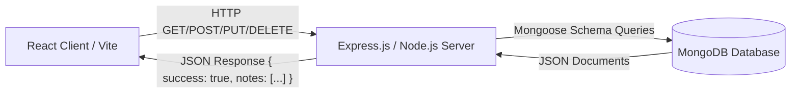

# 📘 NoteNest — Complete Project Walkthrough & Viva Guide

> **Academic MERN Stack Mini-Project Walkthrough**  
> **Project Name:** NoteNest — Personal Notes Manager  
> **Tech Stack:** MongoDB, Express.js, React (Vite), Node.js (MERN)  
> **Target Audience:** College Students preparing for Mini-Project Submissions & Viva Examinations.

---

## 📑 Table of Contents

1. [Project Overview & Architecture](#1-project-overview--architecture)
2. [How the MERN Stack Works Together](#2-how-the-mern-stack-works-together)
3. [Complete File-by-File Walkthrough](#3-complete-file-by-file-walkthrough)
   - **Backend Files:**
     - [server/src/server.js](#1-serversrcserverjs---server-entry-point)
     - [server/src/app.js](#2-serversrcappjs---express-application--middleware)
     - [server/src/config/db.js](#3-serversrcconfigdbjs---mongodb-connection)
     - [server/src/models/Note.js](#4-serversrcmodelsnotejs---mongoose-note-schema)
     - [server/src/routes/note.routes.js](#5-serversrcroutesnoteroutesjs---express-routes)
     - [server/src/controllers/note.controller.js](#6-serversrccontrollersnotecontrollerjs---crud-business-logic)
     - [server/tests/notes.test.js](#7-servertestsnotestestjs---automated-integration-tests)
     - [server/package.json](#8-serverpackagejson---backend-configuration--scripts)
   - **Frontend Files:**
     - [client/src/main.jsx](#9-clientsrcmainjsx---react-dom-entry-point)
     - [client/src/App.jsx](#10-clientsrcappjsx---root-react-component)
     - [client/src/api/axios.js](#11-clientsrcapiaxiosjs---central-axios-instance)
     - [client/src/pages/DashboardPage.jsx](#12-clientsrcpagesdashboardpagejsx---main-notes-workspace)
     - [client/src/components/Sidebar.jsx](#13-clientsrccomponentssidebarjsx---navigation-sidebar)
     - [client/src/components/NoteCard.jsx](#14-clientsrccomponentsnotecardjsx---individual-note-card)
     - [client/src/components/NoteModal.jsx](#15-clientsrccomponentsnotemodaljsx---create--edit-note-modal)
     - [client/src/components/DeleteConfirmModal.jsx](#16-clientsrccomponentsdeleteconfirmmodaljsx---delete-confirmation-dialog)
     - [client/vite.config.js](#17-clientviteconfigjs---vite-build--proxy-configuration)
     - [client/package.json](#18-clientpackagejson---frontend-dependencies--scripts)
4. [Step-by-Step Execution Lifecycles (How Data Flows)](#4-step-by-step-execution-lifecycles)
5. [Top 30 Viva Questions & Student-Friendly Answers](#5-top-30-viva-questions--student-friendly-answers)
6. [Summary Checklist for Evaluation Day](#6-summary-checklist-for-evaluation-day)

---

## 1. Project Overview & Architecture

**NoteNest** is a full-stack personal notes application built on the **MERN** stack:
- **M - MongoDB:** NoSQL database that stores note documents in JSON-like format (BSON).
- **E - Express.js:** Fast, minimalist Node.js web server framework that handles HTTP routing and API requests.
- **R - React (with Vite):** Component-based client library that renders the user interface reactively.
- **N - Node.js:** JavaScript runtime engine that executes backend code outside of a web browser.

### Key Features
1. **Full Note CRUD:** Create, Read, Update, and Delete notes.
2. **Pin to Top:** Toggle pin status so priority notes stay at the top.
3. **Real-Time Search:** Search notes by keyword in title or content with debouncing.
4. **Tag Filtering:** Categorize notes with custom tags; filter notes by clicking tags.
5. **Layout Toggle:** Switch seamlessly between Grid View and List View.
6. **Safe Deletion:** Modal dialog confirms deletion before removing notes permanently.

---

## 2. How the MERN Stack Works Together



1. **User interacts with UI:** When a user types a search term, clicks "New Note", or deletes a note in React, a JavaScript event triggers.
2. **Axios sends HTTP request:** The client uses Axios to send a request (e.g., `POST /api/notes`) to the Express backend.
3. **Express routes and controllers:** The router routes the request to the controller function (`createNote`).
4. **Mongoose talks to MongoDB:** The controller queries the MongoDB collection using the `Note` model.
5. **JSON Response returns to React:** Express returns `{ success: true, note }` to Axios, and React updates its component state (`setNotes(...)`), causing the browser to re-render smoothly without reloading the entire page!

---

## 3. Complete File-by-File Walkthrough

---

### 1. `server/src/server.js` - Server Entry Point

#### Purpose:
This is the starting file for the backend. It connects to the MongoDB database first, then opens the Express server to listen for incoming HTTP traffic on port 5000.

#### Code:
```javascript
// server.js - Backend Entry Point
// This file initializes and starts our Express HTTP server and connects to the database.

const app = require('./app');
const connectDB = require('./config/db');

// Set the port number from environment variables or default to 5000
const PORT = process.env.PORT || 5000;

// Start database connection first, then start listening for HTTP requests
const startServer = async () => {
  try {
    // 1. Connect to MongoDB database
    await connectDB();

    // 2. Start the Express server on specified PORT
    app.listen(PORT, () => {
      console.log(`===============================================`);
      console.log(`🚀 NoteNest Server running on http://localhost:${PORT}`);
      console.log(`📡 Health Check URL: http://localhost:${PORT}/api/health`);
      console.log(`===============================================`);
    });
  } catch (error) {
    console.error('Failed to start server:', error.message);
    process.exit(1); // Exit process if server cannot connect or start
  }
};

// Execute start server function
startServer();
```

#### What You Need to Know:
- **Why separate `server.js` from `app.js`?**  
  `app.js` configures the Express middleware and routes, while `server.js` listens on a network port. This separation allows automated test runners (like Jest/Supertest) to test `app` without binding real network ports.
- **What is `process.env.PORT || 5000`?**  
  It checks if a port is defined in environment variables (e.g., on a hosting server). If not, it falls back to port `5000`.
- **What does `process.exit(1)` do?**  
  It stops the Node.js process with an error code if the database connection fails.

---

### 2. `server/src/app.js` - Express Application & Middleware

#### Purpose:
Configures the Express app, attaches standard middlewares (CORS, body parser), mounts the API routes, and defines a global error handler.

#### Code:
```javascript
// app.js - Express Application Setup & Middleware Configuration
// This file configures Express, attaches middlewares (CORS, JSON parsing), and mounts routes.

const express = require('express');
const cors = require('cors');
const dotenv = require('dotenv');

// Load environment variables from .env file into process.env
dotenv.config();

// Import note routes
const noteRoutes = require('./routes/note.routes');

// Initialize the Express application
const app = express();

// Middleware 1: Enable Cross-Origin Resource Sharing (CORS) so frontend React can talk to backend Express
app.use(cors());

// Middleware 2: Parse incoming JSON request bodies (e.g., req.body in POST and PUT requests)
app.use(express.json());

// Middleware 3: Parse incoming URL-encoded form data
app.use(express.urlencoded({ extended: true }));

// Health check endpoint - useful to quickly test if backend is active
app.get('/api/health', (req, res) => {
  res.status(200).json({
    status: 'ok',
    service: 'NoteNest API',
    time: new Date().toISOString(),
  });
});

// Mount the Notes CRUD API routes at /api/notes
app.use('/api/notes', noteRoutes);

// Global Error Handler Middleware - Catches unhandled errors and returns a clean JSON error response
app.use((err, req, res, next) => {
  console.error('Server Error:', err.message);
  res.status(err.status || 500).json({
    success: false,
    message: err.message || 'Internal Server Error',
  });
});

// Export the app instance so server.js (or tests) can use it
module.exports = app;
```

#### What You Need to Know:
- **What is Middleware?**  
  Functions that execute between receiving a request and sending a response. `cors()` and `express.json()` are examples.
- **Why is `cors()` needed?**  
  Cross-Origin Resource Sharing is a browser security mechanism. Since React runs on port 5173 and Express on port 5000, CORS allows React to fetch data from Express without the browser blocking the request.
- **What is `express.json()`?**  
  It parses incoming HTTP request bodies with JSON payloads and places the parsed data in `req.body`.

---

### 3. `server/src/config/db.js` - MongoDB Connection

#### Purpose:
Establishes the connection to MongoDB using Mongoose.

#### Code:
```javascript
// db.js - MongoDB Connection Configuration
// This file connects our Express application to MongoDB using the Mongoose ODM library.

const mongoose = require('mongoose');

// Asynchronous function to connect to the MongoDB database
async function connectDB() {
  try {
    // Connect to database URI from .env or fallback to local MongoDB instance
    const conn = await mongoose.connect(
      process.env.MONGODB_URI || 'mongodb://127.0.0.1:27017/notenest'
    );

    console.log(`MongoDB connected successfully to host: ${conn.connection.host}`);
  } catch (error) {
    console.error('Database connection failed:', error.message);

    // If database connection fails outside of tests, stop the server
    if (process.env.NODE_ENV !== 'test') {
      process.exit(1);
    }

    throw error;
  }
}

module.exports = connectDB;
```

#### What You Need to Know:
- **What is Mongoose?**  
  Mongoose is an Object Data Modeling (ODM) library for MongoDB and Node.js. It manages relationships between data, provides schema validation, and translates between objects in code and database documents.
- **What is `mongodb://127.0.0.1:27017/notenest`?**  
  `127.0.0.1` is localhost, `27017` is the default MongoDB port, and `notenest` is the database name.

---

### 4. `server/src/models/Note.js` - Mongoose Note Schema

#### Purpose:
Defines the schema for Note documents: fields, data types, defaults, and validation.

#### Code:
```javascript
// Note.js - Mongoose Data Model for Note Documents
// This file defines the structure, data types, and validation rules for notes stored in MongoDB.

const mongoose = require('mongoose');

// Define Schema for notes
const noteSchema = new mongoose.Schema(
  {
    // Title of the note (String, mandatory)
    title: {
      type: String,
      required: [true, 'Note title is required'],
      trim: true,
    },

    // Detailed content of the note (String, mandatory)
    content: {
      type: String,
      required: [true, 'Note content is required'],
      trim: true,
    },

    // Array of string tags for categorizing notes (e.g. ['college', 'project'])
    tags: {
      type: [String],
      default: [],
    },

    // Boolean flag to pin important notes to the top of the list
    isPinned: {
      type: Boolean,
      default: false,
    },
  },
  {
    // Automatically creates and manages 'createdAt' and 'updatedAt' Date fields
    timestamps: true,
  }
);

// Create the 'Note' model from the schema
const Note = mongoose.model('Note', noteSchema);

module.exports = Note;
```

#### What You Need to Know:
- **What is a Schema vs Model?**  
  - **Schema:** The blueprint that defines the structure and rules of the document.
  - **Model:** A compiled wrapper around the schema that provides methods to create, query, update, and delete documents (`Note.find()`, `Note.create()`).
- **What does `{ timestamps: true }` do?**  
  Automatically creates and updates two timestamp fields on each document: `createdAt` and `updatedAt`.
- **What does `trim: true` do?**  
  Strips whitespace from the beginning and end of strings automatically before saving.

---

### 5. `server/src/routes/note.routes.js` - Express Routes

#### Purpose:
Defines REST API endpoints and routes requests to the corresponding controller functions.

#### Code:
```javascript
// note.routes.js - Express Router for Note API Endpoints
// This file maps HTTP URL paths and methods (GET, POST, PUT, DELETE) to their controller functions.

const express = require('express');
const router = express.Router();

// Import controller functions that contain the database logic
const {
  getNotes,
  getNoteById,
  createNote,
  updateNote,
  deleteNote,
} = require('../controllers/note.controller');

// Route for /api/notes
// GET  /api/notes -> List all notes (supports ?search= and ?tag= query params)
// POST /api/notes -> Create a new note
router.route('/')
  .get(getNotes)
  .post(createNote);

// Route for /api/notes/:id
// GET    /api/notes/:id -> Fetch one specific note by its MongoDB _id
// PUT    /api/notes/:id -> Update an existing note by its _id
// DELETE /api/notes/:id -> Delete a note by its _id
router.route('/:id')
  .get(getNoteById)
  .put(updateNote)
  .delete(deleteNote);

module.exports = router;
```

#### What You Need to Know:
- **REST Conventions Used:**
  - `GET /api/notes` &rarr; Retrieve all notes
  - `POST /api/notes` &rarr; Create a new note
  - `GET /api/notes/:id` &rarr; Retrieve one note
  - `PUT /api/notes/:id` &rarr; Update a note
  - `DELETE /api/notes/:id` &rarr; Remove a note
- **What is `:id` in the URL?**  
  A URL parameter (route parameter) accessible in controllers via `req.params.id`.

---

### 6. `server/src/controllers/note.controller.js` - CRUD Business Logic

#### Purpose:
Contains the controller functions that query MongoDB via Mongoose and send JSON responses back to the client.

#### Code:
```javascript
// note.controller.js - Note CRUD Business Logic & Database Operations
// This file contains all handler functions for creating, reading, updating, and deleting notes using Mongoose.

const Note = require('../models/Note');

// 1. Get all notes from MongoDB (with optional search and tag filters)
// Method: GET /api/notes
const getNotes = async (req, res) => {
  try {
    const { search, tag } = req.query;
    let query = {};

    // If search term is provided, filter notes by matching title OR content (case-insensitive)
    if (search && search.trim() !== '') {
      query.$or = [
        { title: { $regex: search.trim(), $options: 'i' } },
        { content: { $regex: search.trim(), $options: 'i' } },
      ];
    }

    // If tag filter is provided, filter notes that include this tag
    if (tag && tag.trim() !== '') {
      query.tags = tag.trim().toLowerCase();
    }

    // Sort: pinned notes first (isPinned: -1), then newest first (updatedAt: -1)
    const notes = await Note.find(query).sort({ isPinned: -1, updatedAt: -1 });

    res.status(200).json({
      success: true,
      count: notes.length,
      notes,
    });
  } catch (error) {
    res.status(500).json({
      success: false,
      message: error.message,
    });
  }
};

// 2. Get a single note by its MongoDB _id
// Method: GET /api/notes/:id
const getNoteById = async (req, res) => {
  try {
    const note = await Note.findById(req.params.id);

    // If note does not exist in database, return 404 Not Found
    if (!note) {
      return res.status(404).json({
        success: false,
        message: 'Note not found',
      });
    }

    res.status(200).json({
      success: true,
      note,
    });
  } catch (error) {
    res.status(500).json({
      success: false,
      message: error.message,
    });
  }
};

// 3. Create a new note in MongoDB
// Method: POST /api/notes
const createNote = async (req, res) => {
  try {
    const { title, content, tags, isPinned } = req.body;

    // Basic validation
    if (!title || !content) {
      return res.status(400).json({
        success: false,
        message: 'Title and content are required fields',
      });
    }

    // Save note in MongoDB
    const note = await Note.create({
      title: title.trim(),
      content: content.trim(),
      tags: Array.isArray(tags) ? tags : [],
      isPinned: Boolean(isPinned),
    });

    res.status(201).json({
      success: true,
      message: 'Note created successfully',
      note,
    });
  } catch (error) {
    res.status(500).json({
      success: false,
      message: error.message,
    });
  }
};

// 4. Update an existing note in MongoDB
// Method: PUT /api/notes/:id
const updateNote = async (req, res) => {
  try {
    const { title, content, tags, isPinned } = req.body;

    // Build the update object with provided fields
    const updateData = {};
    if (title !== undefined) updateData.title = title.trim();
    if (content !== undefined) updateData.content = content.trim();
    if (tags !== undefined) updateData.tags = Array.isArray(tags) ? tags : [];
    if (isPinned !== undefined) updateData.isPinned = Boolean(isPinned);

    // findByIdAndUpdate returns the updated document when { new: true } is passed
    const updatedNote = await Note.findByIdAndUpdate(req.params.id, updateData, {
      new: true,
      runValidators: true,
    });

    if (!updatedNote) {
      return res.status(404).json({
        success: false,
        message: 'Note not found',
      });
    }

    res.status(200).json({
      success: true,
      message: 'Note updated successfully',
      note: updatedNote,
    });
  } catch (error) {
    res.status(500).json({
      success: false,
      message: error.message,
    });
  }
};

// 5. Delete a note permanently from MongoDB
// Method: DELETE /api/notes/:id
const deleteNote = async (req, res) => {
  try {
    const note = await Note.findByIdAndDelete(req.params.id);

    if (!note) {
      return res.status(404).json({
        success: false,
        message: 'Note not found',
      });
    }

    res.status(200).json({
      success: true,
      message: 'Note deleted successfully',
      id: req.params.id,
    });
  } catch (error) {
    res.status(500).json({
      success: false,
      message: error.message,
    });
  }
};

module.exports = {
  getNotes,
  getNoteById,
  createNote,
  updateNote,
  deleteNote,
};
```

#### What You Need to Know:
- **How does regex search work?**  
  `{ $regex: search, $options: 'i' }` performs a case-insensitive regular expression match in MongoDB.
- **Why `{ isPinned: -1, updatedAt: -1 }`?**  
  `-1` means descending order. Pinned notes (`isPinned: true = 1`) come before unpinned notes (`isPinned: false = 0`), and recently updated notes appear first.
- **Why `{ new: true }` in `findByIdAndUpdate`?**  
  By default, Mongoose returns the document *before* the update. `{ new: true }` instructs Mongoose to return the *modified* document.

---

### 7. `server/tests/notes.test.js` - Automated Integration Tests

#### Purpose:
Automated test suite using Jest and Supertest that tests all CRUD operations directly against the database to guarantee code correctness.

#### Code:
```javascript
/**
 * @file notes.test.js
 * @description Integration tests for student Note CRUD, search, tag filters, and pinning.
 */

const request = require('supertest');
const mongoose = require('mongoose');
const app = require('../src/app');
const Note = require('../src/models/Note');

const TEST_DB_URI = 'mongodb://127.0.0.1:27017/notenest_test_notes';

beforeAll(async () => {
  await mongoose.connect(TEST_DB_URI);
  await Note.deleteMany({});
});

afterAll(async () => {
  await Note.deleteMany({});
  await mongoose.connection.close();
});

describe('Notes API (Student Project)', () => {
  let noteId = '';

  it('1. POST /api/notes - Creates a new note', async () => {
    const res = await request(app)
      .post('/api/notes')
      .send({
        title: 'Project Roadmap',
        content: 'Finish MERN stack mini project.',
        tags: ['college', 'project'],
        isPinned: false,
      });

    expect(res.status).toBe(201);
    expect(res.body.success).toBe(true);
    expect(res.body.note).toHaveProperty('_id');
    expect(res.body.note.title).toBe('Project Roadmap');
    noteId = res.body.note._id;
  });

  it('2. GET /api/notes - Lists notes', async () => {
    const res = await request(app).get('/api/notes');

    expect(res.status).toBe(200);
    expect(res.body.success).toBe(true);
    expect(res.body.notes.length).toBe(1);
    expect(res.body.notes[0]._id).toBe(noteId);
  });

  it('3. GET /api/notes/:id - Gets single note by ID', async () => {
    const res = await request(app).get(`/api/notes/${noteId}`);

    expect(res.status).toBe(200);
    expect(res.body.success).toBe(true);
    expect(res.body.note.title).toBe('Project Roadmap');
  });

  it('4. PUT /api/notes/:id - Updates note', async () => {
    const res = await request(app)
      .put(`/api/notes/${noteId}`)
      .send({
        title: 'Updated Project Roadmap',
        isPinned: true,
      });

    expect(res.status).toBe(200);
    expect(res.body.success).toBe(true);
    expect(res.body.note.title).toBe('Updated Project Roadmap');
    expect(res.body.note.isPinned).toBe(true);
  });

  it('5. DELETE /api/notes/:id - Deletes note', async () => {
    const res = await request(app).delete(`/api/notes/${noteId}`);

    expect(res.status).toBe(200);
    expect(res.body.success).toBe(true);

    const check = await request(app).get(`/api/notes/${noteId}`);
    expect(check.status).toBe(404);
  });
});
```

#### What You Need to Know:
- **What is Supertest?**  
  A library that tests Node.js HTTP servers by simulating actual HTTP requests against the Express `app` object without having to run the server on a live port.
- **What are `beforeAll` and `afterAll`?**  
  Jest lifecycle hooks that run setup code before any tests run and cleanup code after all tests complete.

---

### 8. `server/package.json` - Backend Configuration & Scripts

#### Purpose:
Defines project metadata, dependencies (Express, Mongoose, CORS, Dotenv), and runnable scripts (`npm run dev`, `npm test`).

#### Key Scripts:
- `npm run dev`: Runs `nodemon src/server.js` (automatically restarts server when code changes).
- `npm start`: Runs `node src/server.js` (standard Node execution).
- `npm test`: Runs `jest` test runner on integration tests.

---

### 9. `client/src/main.jsx` - React DOM Entry Point

#### Purpose:
The client entry point. Mounts the root React component (`<App />`) into the HTML element `<div id="root"></div>` in `index.html`.

#### Code:
```jsx
import React from 'react';
import ReactDOM from 'react-dom/client';
import App from './App.jsx';
import './styles/index.css';

ReactDOM.createRoot(document.getElementById('root')).render(
  <React.StrictMode>
    <App />
  </React.StrictMode>
);
```

#### What You Need to Know:
- **What is `ReactDOM.createRoot`?**  
  React 18's API that creates a concurrent React root for rendering components into the DOM.
- **What is `<React.StrictMode>`?**  
  A development helper that detects potential problems, deprecated methods, and unexpected side effects.

---

### 10. `client/src/App.jsx` - Root React Component

#### Purpose:
Mounts and renders the main workspace (`DashboardPage`).

#### Code:
```jsx
// App.jsx - Root React Component
// In our student project, App directly mounts the DashboardPage component.

import React from 'react';
import DashboardPage from './pages/DashboardPage';

const App = () => {
  return (
    <div className="app-root">
      {/* Render the main notes workspace */}
      <DashboardPage />
    </div>
  );
};

export default App;
```

#### What You Need to Know:
- Direct, clean, and simple. When the user loads `http://localhost:5173`, `App` directly displays the full Notes dashboard.

---

### 11. `client/src/api/axios.js` - Central Axios Instance

#### Purpose:
Creates a centralized Axios HTTP client that routes all calls to `/api`.

#### Code:
```javascript
// axios.js - Central Axios HTTP Client Setup
// This file creates a reusable Axios instance configured with a base URL for our backend API.

import axios from 'axios';

// Create an Axios instance
const api = axios.create({
  // baseURL '/api' uses Vite's proxy (configured in vite.config.js) to forward requests to http://localhost:5000/api
  baseURL: '/api',
  headers: {
    'Content-Type': 'application/json',
  },
});

export default api;
```

#### What You Need to Know:
- **Why centralize Axios?**  
  Instead of hardcoding `http://localhost:5000/api/notes` across multiple files, centralizing in `api` ensures all components use the same base configuration and headers.

---

### 12. `client/src/pages/DashboardPage.jsx` - Main Notes Workspace

#### Purpose:
The main controller component of the frontend. Manages the notes array state, handles API interactions (GET, POST, PUT, DELETE), controls debounced search, calculates tag counts, and opens modals.

#### What Code Does & Why It Is Written Like That:
1. **State Variables (`useState`):**
   - `notes`: Stores the array of note objects received from MongoDB. Written as React state so the UI automatically re-renders when notes are added, edited, or deleted.
   - `loading`: Tracks API status to show a centered spinner while data loads from the backend.
   - `error`: Holds error text if an API call fails, rendering a warning banner instead of crashing the page.
   - `searchTerm`: Captures text typed into the search bar for live filtering.
   - `currentTab`: Tracks which tab is selected (`all`, `pinned`, `archived`, `trash`).
   - `selectedTag`: Stores tag filter clicked in the sidebar (`#college`).
   - `viewMode`: Toggles between `'grid'` and `'list'` view CSS classes.
   - `isModalOpen` & `activeNote`: Reusable modal state. If `activeNote` is `null`, the modal creates a new note; if `activeNote` has a note object, it pre-fills the form for editing.
   - `deleteModal`: Stores `{ isOpen: boolean, note: object }` for explicit user confirmation before permanent deletion.

2. **Data Fetching (`fetchNotes`):**
   - Sends an asynchronous HTTP `GET /api/notes` using `api.get(...)` with optional query params `{ search, tag }`.
   - On response, stores `res.data.notes` in `notes` state and disables `loading`.

3. **Search Debouncing (`useEffect` + `setTimeout`):**
   - **Why written like that?** Without debouncing, an HTTP request fires on every keystroke as the user types. The 250ms `setTimeout` waits until the user pauses typing before sending the request. The cleanup function `clearTimeout(timer)` cancels any pending call if another key is pressed.

4. **Dynamic Tag Counting (`tagsWithCounts`):**
   - Iterates through the loaded `notes` array and counts occurrences of each tag in a simple JavaScript object (`tagCountsMap`), converting it into an array of `{ name, count }`.

5. **Modal & Action Handlers:**
   - `handleSaveNote(noteData)`: Checks `if (activeNote)` to call `api.put('/notes/:id')` for editing, or `api.post('/notes')` for creating.
   - `handleTogglePin(note)`: Sends `api.put` with `isPinned: !note.isPinned` to quickly pin/unpin notes from the card with one click.
   - `handleConfirmDelete()`: Sends `api.delete('/notes/:id')` only after the user clicks "Delete Note" in the confirmation dialog.

---

### 13. `client/src/components/Sidebar.jsx` - Navigation Sidebar

#### Purpose:
Renders the left navigation panel with the NoteNest logo, "+ New Note" action button, navigation tabs (All Notes, Pinned, Archived, Trash), dynamic tags list, and personal workspace badge.

#### What You Need to Know:
- **`getTagColor(tagName)`**: Deterministically computes a pastel color palette (background, dot, text, border) based on the tag string's character codes.
- **Dynamic Counts**: The count badges next to "All Notes" and "Pinned" directly reflect the live state in `DashboardPage`.

---

### 14. `client/src/components/NoteCard.jsx` - Individual Note Card

#### Purpose:
Displays an individual note item with title, content, pastel tag badges, formatted update date, pin toggle button, edit button, and delete button.

#### What You Need to Know:
- **Props:** Receives `note`, `onEdit`, `onDelete`, and `onTogglePin` from `DashboardPage`.
- **Date Formatting:** Uses `new Date(note.updatedAt).toLocaleDateString(...)` to display readable dates (e.g., "Oct 16, 2026").
- **Pin Visuals:** Applies `.pinned` class to highlight pinned notes with coral borders.

---

### 15. `client/src/components/NoteModal.jsx` - Create & Edit Note Modal

#### Purpose:
A reusable pop-up modal form used for both creating new notes and editing existing notes.

#### What You Need to Know:
- **Dual Mode (Create vs Edit):** If `initialNote` is passed in props, the modal populates form inputs with that note's title, content, tags, and pin status. If `null`, inputs are reset for a fresh note.
- **Live Tag Preview:** Parses comma-separated input (`"college, exam, mern"`) and renders live pastel tag chips instantly as the user types.
- **Validation:** Enforces non-empty title (up to 120 chars) and non-empty content before submitting.

---

### 16. `client/src/components/DeleteConfirmModal.jsx` - Delete Confirmation Dialog

#### Purpose:
Provides defensive user experience (UX) by prompting for explicit confirmation before permanently deleting a note from MongoDB.

#### What You Need to Know:
- Displays the exact title of the note about to be deleted.
- Shows a loading spinner and disables buttons while the deletion request is processing (`isDeleting`).

---

### 17. `client/vite.config.js` - Vite Build & Proxy Configuration

#### Purpose:
Configures the Vite development server and sets up an API proxy:

```javascript
import { defineConfig } from 'vite';
import react from '@vitejs/plugin-react';

export default defineConfig({
  plugins: [react()],
  server: {
    port: 5173,
    proxy: {
      '/api': {
        target: 'http://localhost:5000',
        changeOrigin: true,
        secure: false,
      },
    },
  },
});
```

#### What You Need to Know:
- **Why use a proxy?**  
  When React requests `/api/notes`, Vite intercepts it and silently forwards it to `http://localhost:5000/api/notes`. This prevents CORS issues in development and allows the frontend to use relative URLs (`/api`).

---

### 18. `client/package.json` - Frontend Dependencies & Scripts

#### Purpose:
Specifies frontend dependencies:
- `react` & `react-dom`: UI rendering engine
- `axios`: HTTP client
- `vite`: Fast build tool and dev server

#### Scripts:
- `npm run dev`: Starts local Vite dev server at `http://localhost:5173`
- `npm run build`: Bundles the application into static HTML/CSS/JS in `client/dist`

---

## 4. Step-by-Step Execution Lifecycles

### Lifecycle 1: Loading All Notes on Initial Visit
1. User opens `http://localhost:5173`.
2. React mounts `<App />` &rarr; mounts `<DashboardPage />`.
3. `useEffect` in `DashboardPage` fires and calls `fetchNotes()`.
4. Axios issues `GET /api/notes`.
5. Express matches route `router.route('/').get(getNotes)` in `note.routes.js`.
6. `getNotes` in `note.controller.js` runs `Note.find().sort({ isPinned: -1, updatedAt: -1 })`.
7. MongoDB returns matching documents.
8. Express responds with `{ success: true, count: N, notes: [...] }`.
9. React sets `notes` in state (`setNotes(...)`).
10. Component re-renders, displaying pinned notes and other notes in the grid.

### Lifecycle 2: Creating a New Note
1. User clicks the "+ New Note" button in the Sidebar.
2. `handleOpenCreateModal()` sets `activeNote = null` and `isModalOpen = true`.
3. `<NoteModal />` opens with empty fields.
4. User enters title, content, tags, toggles pin, and clicks "Save Note".
5. Form triggers `handleSubmit(e)` &rarr; `handleSaveNote(noteData)`.
6. Axios sends `POST /api/notes` with JSON payload.
7. Express body parser parses `req.body`.
8. `createNote` controller executes `Note.create(...)`.
9. MongoDB inserts document, generates unique `_id`, and sets `createdAt`/`updatedAt`.
10. Backend responds with `201 Created` and the new note object.
11. Frontend closes modal (`setIsModalOpen(false)`) and calls `fetchNotes()` to refresh the dashboard.

### Lifecycle 3: Real-Time Debounced Search
1. User types "exam" in the top search box.
2. `searchTerm` state updates on each keystroke.
3. `useEffect` debounce timer waits 250 milliseconds after the last keystroke.
4. After 250ms of inactivity, `fetchNotes("exam", "")` executes.
5. Axios sends `GET /api/notes?search=exam`.
6. Express controller builds query:
   ```javascript
   query.$or = [
     { title: { $regex: 'exam', $options: 'i' } },
     { content: { $regex: 'exam', $options: 'i' } }
   ];
   ```
7. MongoDB searches for any note matching "exam" regardless of uppercase/lowercase.
8. Filtered notes return to React and populate the screen instantly.

---

## 5. Top 30 Viva Questions & Student-Friendly Answers

### Section A: Architecture & MERN Stack

#### Q1: What is the MERN stack and why did you choose it for this project?
**Answer:** MERN stands for MongoDB, Express.js, React, and Node.js. We chose it because it uses a single language—JavaScript—across both frontend and backend. This provides seamless JSON data exchange, fast development, and high performance.

#### Q2: What is the difference between SQL and NoSQL?
**Answer:** SQL databases (like MySQL) store data in rigid, relational tables with fixed schemas and foreign keys. NoSQL databases (like MongoDB) store data in flexible, JSON-like document formats (BSON) that easily adapt to changing data requirements without rigid migrations.

#### Q3: Why is React used on the frontend instead of vanilla HTML/JS?
**Answer:** React uses a Virtual DOM and a component-based architecture. When data changes, React efficiently updates only the specific elements that changed rather than reloading the entire webpage.

#### Q4: What is the role of Node.js in this project?
**Answer:** Node.js is an open-source JavaScript runtime environment built on Chrome's V8 engine that allows us to execute JavaScript on the server side to handle HTTP requests and database operations.

#### Q5: What is Express.js?
**Answer:** Express.js is a minimalist web framework for Node.js. It simplifies building web servers by providing routing, middleware integration, and request/response helpers.

---

### Section B: Backend & Database

#### Q6: What is Mongoose and why is it used?
**Answer:** Mongoose is an ODM (Object Data Modeling) library for MongoDB. It allows us to define schemas, set data validation rules, and easily run CRUD queries using JavaScript objects.

#### Q7: What are HTTP status codes? Which ones did you use?
**Answer:** HTTP status codes communicate the result of an HTTP request:
- `200 OK`: Request succeeded (used in GET, PUT, DELETE).
- `201 Created`: Resource successfully created (used in POST).
- `400 Bad Request`: Client input error (e.g., missing required title or content).
- `404 Not Found`: Requested note ID does not exist in the database.
- `500 Internal Server Error`: Unhandled server-side error.

#### Q8: What is CORS and why is it necessary?
**Answer:** CORS stands for Cross-Origin Resource Sharing. Because our frontend runs on `http://localhost:5173` and our backend runs on `http://localhost:5000`, browsers block cross-origin requests by default. The `cors()` middleware in Express informs the browser that requests from our React app are permitted.

#### Q9: What is the purpose of `express.json()` middleware?
**Answer:** By default, Node.js receives HTTP request bodies as raw data streams. `express.json()` intercepts incoming requests, parses the JSON payload, and populates `req.body` as a usable JavaScript object.

#### Q10: How does note sorting work in your backend?
**Answer:** In `note.controller.js`, we use:
```javascript
Note.find(query).sort({ isPinned: -1, updatedAt: -1 });
```
`-1` specifies descending order. Pinned notes (`isPinned: true = 1`) come first, followed by unpinned notes (`0`). Notes with the newest `updatedAt` timestamp appear at the top.

#### Q11: How did you implement search?
**Answer:** We pass the search keyword as a query parameter (`/api/notes?search=keyword`) and use MongoDB's `$regex` operator with the `$options: 'i'` flag. This performs a case-insensitive search across both the note's `title` and `content` using the `$or` operator.

#### Q12: What does `{ new: true }` do in `findByIdAndUpdate`?
**Answer:** By default, Mongoose returns the document before updates were applied. Specifying `{ new: true }` instructs Mongoose to return the freshly updated document.

---

### Section C: Frontend & React Concepts

#### Q13: What are React Hooks? Which ones did you use?
**Answer:** Hooks are special functions that let function components use state and other React features. We used:
- `useState`: Manages local component state (e.g., notes, search text, modal visibility).
- `useEffect`: Performs side effects (fetching notes on component mount, debouncing search).
- `useCallback`: Memoizes the `fetchNotes` function to prevent unnecessary re-creations.
- `useMemo`: Caches calculated values (e.g., tag counts, pinned notes list) to optimize rendering performance.

#### Q14: What is Search Debouncing and why is it important?
**Answer:** Debouncing delays the execution of a function until a certain amount of time has elapsed since the last keystroke (in our case, 250ms). Without debouncing, an HTTP request would be sent on every single keystroke, overloading the server and causing UI flickering.

#### Q15: What is Vite and why is it preferred over Create React App (CRA)?
**Answer:** Vite is a modern frontend build tool that leverages native ES modules. It provides near-instant server start-up, lightning-fast Hot Module Replacement (HMR), and optimized production builds with Rollup.

#### Q16: How do components communicate in React?
**Answer:** Components communicate via **props** (properties passed downwards from parent to child) and **callbacks** (functions passed down as props that children call to pass data back up to parents).

#### Q17: Why do list items need a `key` prop in React?
**Answer:** The `key` prop gives elements a stable identity across renders. It helps React's reconciliation algorithm identify which items were changed, added, or removed, avoiding unnecessary re-renders. We use each note's unique MongoDB `_id` as the key.

#### Q18: What is the difference between controlled and uncontrolled components?
**Answer:** In controlled components (like our Note Modal form inputs), form data is handled by React component state using `value` and `onChange`. In uncontrolled components, form data is handled by the DOM itself.

---

### Section D: Testing & Project Execution

#### Q19: What is Jest and Supertest?
**Answer:**
- **Jest:** A JavaScript testing framework providing test runners, assertion libraries (`expect`), and mocks.
- **Supertest:** An HTTP assertion library that simulates HTTP requests against Express apps to test REST endpoints without opening live ports.

#### Q20: How do you run the project locally?
**Answer:**
1. Start MongoDB: `mongod`
2. Start Backend: In `/server`, run `npm run dev` (starts on port 5000).
3. Start Frontend: In `/client`, run `npm run dev` (starts on port 5173).
4. Run Tests: In `/server`, run `npm test`.

---

## 6. Summary Checklist for Evaluation Day

| Checklist Item | Status | Verification Command |
|---|---|---|
| MongoDB Connection | ✅ Working | Verified via `server/src/config/db.js` |
| Express REST API | ✅ Working | Verified via `server/src/app.js` |
| Full CRUD Functionality | ✅ Working | Create, Read, Update, Delete tested |
| Automated Integration Tests | ✅ 5/5 Passed | `npm test` in `/server` |
| Frontend Production Build | ✅ 0 Errors | `npm run build` in `/client` |
| Clean Student Comments | ✅ Added | Present across all client & server files |
| No Auth / Sign-in Complexity | ✅ Removed | Clean, direct access to notes workspace |

---
*Created for academic mini-project submission and viva evaluation.*
